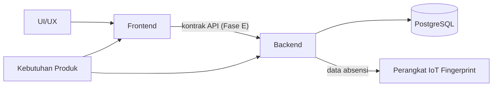

# 01 — Project Overview: LIMEN

- **Nama proyek:** LIMEN (Sistem Absensi Terintegrasi)
- **Status dokumen:** Draft untuk ditinjau stakeholder
- **Tanggal:** 2026-10-11
- **Dokumen terkait:** [00-project-audit.md](./00-project-audit.md) · [02-prd.md](./02-prd.md)

> Dokumen ini merangkum konteks proyek. Rincian temuan teknis ada di [00-project-audit.md](./00-project-audit.md); rincian kebutuhan produk ada di [02-prd.md](./02-prd.md). Hindari duplikasi isi.

## 1. Ringkasan Proyek

LIMEN adalah aplikasi web Sistem Absensi Terintegrasi untuk lingkungan sekolah. Absensi siswa dilakukan melalui perangkat **IoT fingerprint**, dan guru dapat menetapkan status absensi siswa secara manual bila siswa belum tercatat absen. Selain absensi, repositori saat ini memuat sejumlah fitur pendukung (quiz/latihan soal, penilaian, rekap, konseling, minat bakat, passing grade) yang dinyatakan **in-scope** oleh stakeholder.

Kondisi saat ini: repositori berisi **implementasi frontend** (React + TypeScript + Vite + Tailwind). Seluruh data masih berupa mock/inline, tidak ada backend, tidak ada autentikasi, dan tidak ada integrasi API — lihat [00-project-audit.md](./00-project-audit.md) AUD-001 s.d. AUD-004.

## 2. Latar Belakang dan Masalah yang Hendak Diselesaikan

- Proses absensi sekolah perlu terintegrasi (perangkat IoT fingerprint) dan terpusat agar dapat dipantau oleh guru, guru wali, guru BK, dan admin.
- Kondisi teknis saat ini: fondasi frontend tersedia namun belum terstruktur, berisi duplikasi, tanpa kontrak API, autentikasi, atau pengujian (lihat audit).
- Belum ada PRD, SRS, arsitektur, kontrak API, maupun skema database — sehingga arahan implementasi lintas tim belum jelas.

## 3. Tujuan Proyek

1. Mendokumentasikan kebutuhan produk dan sistem sebagai acuan seluruh tim.
2. Menyusun arsitektur frontend, backend (Go), dan database (PostgreSQL) yang proporsional.
3. Menetapkan kontrak API sebagai batas integrasi frontend–backend.
4. Menegakkan autentikasi/otorisasi berbasis peran yang jelas.
5. Menyediakan kriteria penerimaan yang objektif dan dapat diuji.
6. Menjaga perubahan desain UI/UX agar tidak merusak business logic.

## 4. Lingkup Sistem (Sementara)

**In-scope (dikonfirmasi stakeholder):** seluruh fitur yang tampak pada antarmuka, meliputi absensi (IoT fingerprint + penentuan status oleh guru), dashboard, jadwal, quiz/latihan soal, penilaian, tugas, koreksi, rekap, rapor, konseling, minat bakat, passing grade, notifikasi, dan admin sekolah.

**Rincian aturan bisnis** yang belum tersedia ditandai `TBD` dan didokumentasikan sebagai pertanyaan terbuka di [02-prd.md](./02-prd.md).

## 5. Teknologi

### 5.1 Digunakan saat ini (terverifikasi dari repositori)

| Bagian | Teknologi | Bukti |
| --- | --- | --- |
| Frontend | React 19, TypeScript ~6.0 | `package.json:18`, `tsconfig.app.json` |
| Build/tooling | Vite 8 | `package.json:35`, `vite.config.ts` |
| Styling | Tailwind CSS v4 | `package.json:17,21`, `src/index.css:1` |
| Routing | React Router DOM 7 | `package.json:20`, `src/App.tsx` |
| Ikon/UI | MUI icons (dan sedikit `@mui/material`) | `package.json:15-16` |
| Lint | ESLint flat config (non-type-aware) | `eslint.config.js` |

### 5.2 Direncanakan (belum ada implementasi)

| Bagian | Teknologi | Status |
| --- | --- | --- |
| Backend | Go | Direncanakan (belum ada kode) |
| Database | PostgreSQL | Direncanakan (belum ada skema) |
| Integrasi perangkat | IoT fingerprint | Dikonfirmasi stakeholder; mekanisme integrasi `TBD` |

Rekomendasi detail (framework HTTP, driver DB, ORM, migrasi, autentikasi) akan ditetapkan pada Fase D (`05-sdd.md`) dan dicatat di `09-decision-log.md`.

## 6. Kondisi Implementasi Saat Ini

Ringkasan (rinci per temuan di [00-project-audit.md](./00-project-audit.md)):

- 171 berkas sumber, 15 area fitur, 62 route inline; tanpa layout route, lazy loading, atau route guard.
- Data mock/inline; tidak ada API/env; tidak ada autentikasi/sesi; tanpa state global.
- Tidak ada test, tanpa `ErrorBoundary`; lint tanpa type-checking.
- Duplikasi berkas identik (mis. `bankSoalData` ≡ `bankSoalDataUjian`; dua berkas `RekapNilai`), penamaan tidak konsisten (typo "Penialaian"), kode mati/placeholder.
- Bug fungsional: param quiz tidak cocok (AUD-002), impor/route bank soal Ujian salah (AUD-003).

## 7. Peran Tim dan Tanggung Jawab

| Tim | Tanggung jawab |
| --- | --- |
| Frontend | Implementasi UI/interaksi (React, TS, Vite, Tailwind, React Router); persiapan integrasi API; perbaikan fondasi sesuai audit |
| Backend | Backend Go, PostgreSQL, autentikasi, otorisasi, pemrosesan data, API, migrasi |
| UI/UX | Acuan desain; **saat ini belum ada berkas/hyperlink desain resmi**, sehingga design token akan disusun sendiri dan dicatat untuk dikoreksi |
| Stakeholder | Menjawab pertanyaan terbuka dan menyetujui keputusan produk |

## 8. Dependensi Antartim

- **Frontend ⇄ Backend:** bergantung pada API contract yang belum disetujui.
- **Backend ⇄ IoT:** bergantung pada mekanisme integrasi perangkat (belum ditentukan).
- **Frontend ⇄ UI/UX:** desain resmi belum tersedia; komponen dibangun mobile-first.

## 9. Risiko dan Pertanyaan Terbuka

| ID | Risiko/pertanyaan | Dampak | Status |
| --- | --- | --- | --- |
| RSK-001 | Lingkup produk sangat luas (absensi + quiz + minat bakat + passing grade + admin) untuk satu fase | Prioritas & sumber daya tidak jelas | Open |
| RSK-002 | Tidak ada autentikasi/guard di frontend (AUD-001) | Risiko keamanan; integrasi tertunda | Open |
| RSK-003 | Belum ada kontrak API/skema data | Integrasi antartim terhambat | Open |
| RSK-004 | Belum ada acuan desain resmi | Perubahan visual berulang | Open |
| RSK-005 | Duplikasi & bug fungsional pada fondasi (AUD-002, AUD-003, AUD-008) | Bug menyebar sebelum refactor | Open |
| RSK-006 | Integrasi perangkat IoT fingerprint belum ditentukan | Fitur inti absensi berisiko | Open |

Pertanyaan terbuka rinci (atribut absensi, IoT, sesi, dsb.) ada di [02-prd.md](./02-prd.md) bagian Pertanyaan Terbuka.

## 10. Ringkasan Masalah Utama (dari Audit)

1. Tidak ada autentikasi/sesi/guard (AUD-001).
2. Param route quiz tidak cocok → fitur tidak dapat dibuka (AUD-002).
3. Impor/route bank soal Ujian salah + kode mati (AUD-003).
4. Tidak ada lapisan API/konfigurasi environment (AUD-004).
5. Tanpa penanganan error/loading/empty (AUD-006) dan tanpa test (AUD-007).

Langkah implementasi lanjutan didaftarkan di `04-wbs.md` (Fase F) dan keputusan di `09-decision-log.md`.
