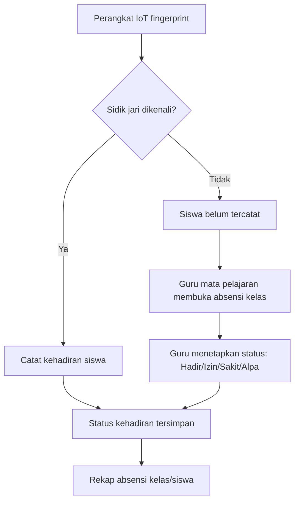
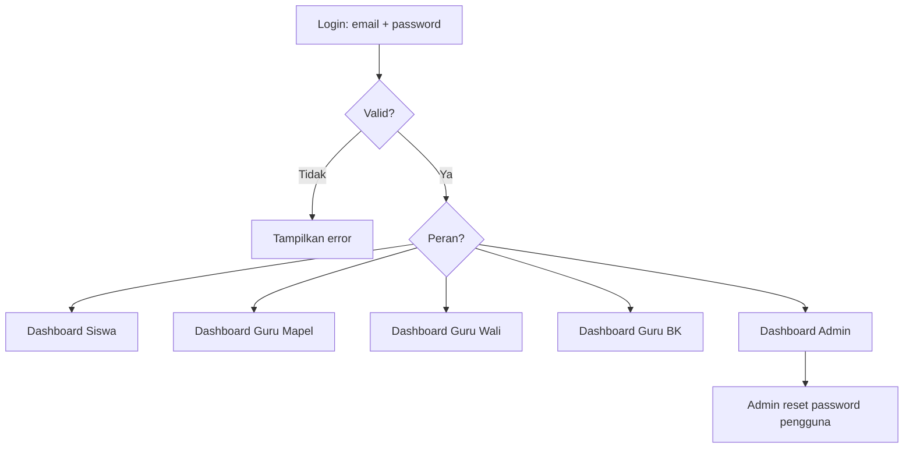
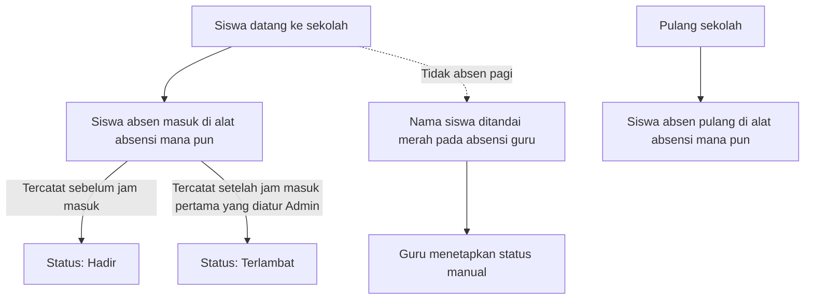

# 02 — PRD: LIMEN (Sistem Absensi Terintegrasi)

- **Status dokumen:** Draft untuk ditinjau stakeholder
- **Versi:** 0.1
- **Tanggal:** 2026-10-11
- **Dokumen terkait:** [00-project-audit.md](./00-project-audit.md) · [01-project-overview.md](./01-project-overview.md)

## Cara Membaca Dokumen Ini

Setiap butir diberi label klasifikasi agar jelas dasar dan statusnya:

| Label | Arti |
| --- | --- |
| **(F)** Fakta terkonfirmasi | Didukung kode repositori atau pernyataan stakeholder (dengan sumber). |
| **(I) Kebutuhan tersimpulkan** | Dapat disimpulkan dengan keyakinan memadai dari fakta, namun belum dinyatakan eksplisit. |
| **(P) Usulan** | Fitur/aturan yang diusulkan dan **belum disetujui**. |
| **(A) Asumsi sementara** | Diperlukan untuk menyusun rancangan; harus divalidasi. |

Aturan penulisan: **tampilan UI bukan bukti tunggal** bahwa sebuah fitur adalah kebutuhan bisnis. Fitur yang hanya muncul pada UI diberi label **(P)** kecuali didukung fakta lain. Prioritas memakai MoSCoW (**Must / Should / Could**). Nilai yang belum ditentukan ditandai **TBD** dengan usulan awal.

## 1. Product Overview

LIMEN adalah aplikasi web Sistem Absensi Terintegrasi untuk sekolah. Absensi siswa direkam melalui perangkat **IoT fingerprint**; bila siswa belum tercatat absen, guru dapat menetapkan status absensi secara manual. Aplikasi melayani lima peran: Siswa, Guru Mata Pelajaran, Guru Wali, Guru BK, dan Admin Sekolah. **(F)** Platform bersifat **mobile-first**. **(F)** Autentikasi menggunakan email dan password, dengan reset password dilakukan oleh Admin. **(F)**

## 2. Problem Statement

- Absensi manual/terpisah tidak terpusat dan sulit dipantau lintas peran. **(I)**
- Belum ada sistem terintegrasi untuk merekam absensi dari perangkat IoT dan koreksi oleh guru. **(I)**
- Belum ada kanal terpadu untuk jadwal, penilaian, rekap, dan rapor siswa. **(I)**
- Kebutuhan produk belum terdokumentasi, sehingga arah implementasi antartim tidak konsisten. **(F, AUD-018)**

## 3. Tujuan dan Indikator Keberhasilan

| ID | Tujuan | Indikator (usulan awal) |
| --- | --- | --- |
| GOAL-01 | Absensi siswa tercatat otomatis dari IoT fingerprint | % sesi absensi terekam tanpa input manual |
| GOAL-02 | Guru dapat menetapkan/koreksi status absensi | % sTatus absensi yang dapat diselesaikan guru tanpa eskalasi |
| GOAL-03 | Data absensi/penilaian terpusat & dapat direkap | Rekap tersedia per kelas/siswa/periode |
| GOAL-04 | Akses sesuai peran | 100% route terlindungi sesuai peran **(P)** |

Target kuantitatif indikator = **TBD** (usulan: lihat bagian 11).

## 4. Target Pengguna dan Persona

Dikonfirmasi stakeholder. **(F)**

| Persona | Deskripsi | Kebutuhan utama (usulan) |
| --- | --- | --- |
| Siswa | Peserta didik; absen via IoT; melihat jadwal, nilai, quiz | Melihat kehadiran & jadwal; mengerjakan quiz/tugas |
| Guru Mata Pelajaran | Mengajar mapel; kelola absensi kelas, tugas, penilaian, bank soal | Absensi kelas + penentuan status, penilaian, tugas, koreksi |
| Guru Wali | Wali kelas; memantau kehadiran, rapor, konseling | Rekap kehadiran, rapor, catatan konseling |
| Guru BK | Bimbingan konseling; rekap & minat bakat | Konseling, rekap, minat bakat |
| Admin Sekolah | Administrasi; kelola pengguna, reset password, data akademik | Manajemen pengguna & data master, reset password |

## 5. User Needs dan Pain Points

- **Siswa:** tahu kehadiran & jadwal real-time; riwayat quiz. **(I)**
- **Guru:** mencatat/mengoreksi absensi cepat saat perangkat tidak mencatat; mengelola nilai & tugas. **(I)**
- **Guru Wali/BK:** memantau kehadiran & perilaku siswa. **(I)**
- **Admin:** mengelola akun (termasuk reset password) dan data akademik. **(F untuk reset password)**
- **Pain point saat ini:** seluruh data mock, tidak ada autentikasi, navigasi/route sebagian rusak. **(F, AUD-001/002/003)**

## 6. Product Scope

### 6.1 In-Scope (dikonfirmasi)

Seluruh fitur yang tampak pada aplikasi dinyatakan in-scope oleh stakeholder: **(F)**

`Autentikasi & Peran`, `Dashboard`, `Absensi (IoT fingerprint + koreksi guru)`, `Jadwal`, `Quiz/Latihan Soal`, `Penilaian`, `Tugas`, `Koreksi`, `Rekap`, `Rapor`, `Konseling`, `Minat Bakat`, `Passing Grade`, `Riwayat Quiz`, `Notifikasi`, `Admin Sekolah`.

### 6.2 Out of Scope (usulan)

- Modul pembayaran/keuangan, perpustakaan, dan ekstrakurikuler — tidak ditemukan bukti maupun permintaan. **(P)**
- Aplikasi mobile native (fokus web mobile-first). **(P)**

## 7. Daftar Fitur dan Prioritas

Prioritas = MoSCoW (usulan; **belum disetujui**). Label klasifikasi menjelaskan dasar keberadaan fitur.

| ID | Modul | Deskripsi singkat | Label | Prioritas | Sumber dasar |
| --- | --- | --- | --- | --- | --- |
| FEAT-AUTH-01 | Autentikasi | Login email + password | (F) | Must | Stakeholder; `Login.tsx` |
| FEAT-AUTH-02 | Autentikasi | Reset password oleh Admin | (F) | Must | Stakeholder |
| FEAT-AUTH-03 | Autentikasi | Otorisasi/gate route per peran | (I) | Must | Audit AUD-001, AUD-013 |
| FEAT-AUTH-04 | Autentikasi | Logout | (I) | Must | Umum |
| FEAT-ABS-01 | Absensi | Perekaman kehadiran otomatis dari IoT fingerprint | (F) | Must | Stakeholder |
| FEAT-ABS-02 | Absensi | Guru menetapkan status bila siswa belum absen | (F) | Must | Stakeholder |
| FEAT-ABS-03 | Absensi | Lihat riwayat/detail absensi per siswa/kelas | (I) | Must | Kode `guruMapel/absensi/*`, `guruWali/absensi/*` |
| FEAT-ABS-05 | Absensi | Absen pulang (check-out) setelah jam pulang via alat absensi | (F) | Must | Stakeholder (dikoreksi) |
| FEAT-ABS-06 | Absensi | Dukungan lebih dari satu alat absensi; siswa bebas memilih alat | (F) | Must | Stakeholder (dikoreksi) |
| FEAT-ABS-07 | Absensi | Nama siswa ditandai merah pada absensi guru bila belum absen pagi | (F) | Must | Stakeholder (dikoreksi) |
| FEAT-ABS-08 | Absensi | Admin mengatur jam masuk pertama (acuan keterlambatan) | (F) | Must | Stakeholder (dikoreksi) |
| FEAT-ABS-09 | Absensi | Guru (Mapel/Wali/BK) dapat absen masuk & pulang via alat absensi | (F) | Must | Stakeholder (dikoreksi) |
| FEAT-ABS-10 | Absensi | Admin meninjau absensi guru; guru belum absen ditandai merah | (F) | Must | Stakeholder (dikoreksi) |
| FEAT-ABS-04 | Absensi | Koreksi absensi & mekanisme persetujuan | (P) | Should | Stakeholder (TBD) |
| FEAT-DASH-01 | Dashboard | Beranda per peran dengan menu sesuai peran | (I) | Must | `dashboard/*` |
| FEAT-JADWAL-01 | Jadwal | Lihat jadwal pelajaran/ujian/tryout | (I) | Should | `jadwal/*` |
| FEAT-QUIZ-01 | Quiz | Mengerjakan quiz (5 tipe soal) | (I) | Should | `quiz/*` |
| FEAT-QUIZ-02 | Quiz | Riwayat & hasil quiz siswa | (I) | Should | `riwayat-quiz/*`, `quiz-result/*` |
| FEAT-LATIHAN-01 | Latihan | Daftar latihan soal per mapel | (I) | Should | `latihan-soal/*` |
| FEAT-GURU-BANKSOAL-01 | Guru | Bank soal latihan & ujian (buat/edit) | (I) | Should | `guru/LatihanSoal/*`, `guru/Ujian/*` |
| FEAT-GURU-TUGAS-01 | Guru | Kelola & nilai tugas | (I) | Should | `guru/Tugas/*` |
| FEAT-GURU-PENILAIAN-01 | Guru | Input/rekap penilaian per kelas/siswa | (I) | Should | `guru/Penilaian/*` |
| FEAT-GURU-KOREKSI-01 | Guru | Koreksi jawaban siswa & remedial | (I) | Should | `guru/Koreksi/*` |
| FEAT-WALI-01 | Guru Wali | Rekap absensi siswa per kelas | (I) | Must | `guruWali/absensi/*` |
| FEAT-WALI-02 | Guru Wali | Rapor siswa & detail nilai | (I) | Should | `guruWali/rapotSiswa/*` |
| FEAT-WALI-03 | Guru Wali | Catatan konseling & tindak lanjut | (I) | Should | `guruWali/konselingWali/*` |
| FEAT-BK-01 | Guru BK | Konseling siswa | (I) | Should | `guruBK/Konseling/*` |
| FEAT-BK-02 | Guru BK | Rekap absensi & nilai | (I) | Should | `guruBK/Rekap/*` |
| FEAT-BK-03 | Guru BK | Minat bakat siswa | (I) | Should | `guruBK/MinatBakat/*` |
| FEAT-SISWA-01 | Siswa | Minat bakat & rekomendasi jurusan | (I) | Could | `hasil-minat-bakat/*` |
| FEAT-SISWA-02 | Siswa | Passing grade perguruan tinggi | (I) | Could | `passing-grade/*` |
| FEAT-NOTIF-01 | Notifikasi | Daftar notifikasi | (I) | Could | `notifikasi/*` |
| FEAT-ADMIN-01 | Admin | Manajemen pengguna (peran, status) | (I) | Must | `admin/section/ManajemenPengguna.tsx` |
| FEAT-ADMIN-02 | Admin | Reset password pengguna | (F) | Must | Stakeholder |
| FEAT-ADMIN-03 | Admin | Data akademik & jadwal | (I) | Should | `admin/section/AkademikDanJadwal.tsx` |
| FEAT-ADMIN-04 | Admin | Presensi & rekap nilai rapor | (I) | Should | `admin/section/Presensi.tsx`, `NilaiRapor.tsx` |
| FEAT-SYS-01 | Sistem | Integrasi perangkat IoT fingerprint | (F) | Must | Stakeholder (mekanisme TBD) |

Catatan: `GuruRemedial` (`src/features/guru/Remedial/GuruRemedial.tsx:4-11`) masih placeholder kosong → fitur "Remedial mandiri" berstatus **(P)** dan belum dianggap selesai.

## 8. User Journey dan User Flow

### 8.1 Alur absensi (usulan, perlu koreksi)

### 8.2 Alur autentikasi (dikonfirmasi + usulan)

## 9. User Stories

Format: *Sebagai <peran>, saya ingin <aksi>, agar <manfaat>.* Label + prioritas mengikuti Bagian 7.

| ID | Peran | User story | Fitur | Label | Prioritas |
| --- | --- | --- | --- | --- | --- |
| US-01 | Siswa | Login dengan email & password untuk mengakses aplikasi | FEAT-AUTH-01 | (F) | Must |
| US-02 | Siswa | Melihat rekap kehadiran saya | FEAT-ABS-03 | (I) | Must |
| US-03 | Guru Mapel | Menetapkan status absensi siswa yang belum tercatat IoT | FEAT-ABS-02 | (F) | Must |
| US-04 | Guru Mapel | Mengisi/merekap penilaian kelas | FEAT-GURU-PENILAIAN-01 | (I) | Should |
| US-05 | Guru Wali | Memantau kehadiran siswa kelas saya | FEAT-WALI-01 | (I) | Must |
| US-06 | Guru BK | Mencatat konseling & tindak lanjut | FEAT-BK-01 | (I) | Should |
| US-07 | Admin | Mengelola akun pengguna dan perannya | FEAT-ADMIN-01 | (I) | Must |
| US-08 | Admin | Mereset password pengguna | FEAT-ADMIN-02 | (F) | Must |
| US-09 | Siswa | Mengerjakan quiz dan melihat hasilnya | FEAT-QUIZ-01/02 | (I) | Should |

(User story rinci per fitur akan dilengkapi pada `03-srs.md`.)

## 10. Aturan Bisnis

| ID | Aturan | Label | Catatan |
| --- | --- | --- | --- |
| BR-01 | Autentikasi hanya menggunakan email dan password | (F) | Stakeholder |
| BR-02 | Reset password hanya dapat dilakukan oleh Admin | (F) | Stakeholder |
| BR-03 | Absensi siswa direkam melalui perangkat IoT fingerprint: absen masuk pagi saat datang, absen pulang setelah jam pulang | (F) | Stakeholder (dikoreksi) |
| BR-04 | Bila siswa tercatat absen via IoT, status kehadiran berasal dari perangkat; guru dapat menetapkan status bila siswa belum tercatat | (F) | Status: `TBD` |
| BR-05 | Absensi harus melalui autentikasi & otorisasi per peran | (I) | Turunan AUD-001 |
| BR-06 | Siswa dihitung terlambat hanya bila absen masuk melewati jam masuk pertama yang diatur Admin (contoh 7:15 WIB) | (F) | Stakeholder; jam masuk dikonfigurasi Admin |
| BR-07 | Prosedur koreksi absensi dan persetujuannya | (P) | **TBD** |
| BR-08 | Apakah absensi memerlukan bukti tambahan (selfie/QR/geofence) di luar fingerprint | (P) | Usulan: di luar lingkup awal |
| BR-09 | Kebijakan retensi & audit data absensi | (P) | **TBD** |
| BR-10 | Bila siswa belum absen pagi, namanya ditandai merah pada absensi guru | (F) | Stakeholder (dikoreksi) |
| BR-11 | Terdapat lebih dari satu alat absensi; siswa bebas absen di alat mana pun | (F) | Stakeholder (dikoreksi) |
| BR-12 | Zona waktu acuan absensi adalah WIB (Asia/Jakarta) | (F) | Turunan contoh jam 7:15 WIB |
| BR-13 | Guru (Mapel/Wali/BK) dapat absen masuk & pulang via alat absensi; memakai jam masuk yang sama dengan siswa dan dikenai aturan Terlambat; Admin meninjau absensi guru dan menandai merah guru yang belum absen | (F) | Stakeholder (dikoreksi) |

### 10.1 Alur Absensi Harian (Confirmed)

## 11. Kebutuhan Nonfungsional Tingkat Produk

| ID | Aspek | Kebutuhan | Label |
| --- | --- | --- | --- |
| NFR-P-01 | Platform | Tampilan mobile-first; dapat diakses di desktop | (F) |
| NFR-P-02 | Bahasa | Antarmuka berbahasa Indonesia (`html lang="id"`) | (I) |
| NFR-P-03 | Keamanan | Wajib login; validasi otorisasi di backend, bukan hanya frontend | (I) |
| NFR-P-04 | Kinerja | Halaman utama termuat cepat di jaringan sekolah (target: **TBD**, usulan p95 < 3 s pada 3G cepat) | (P) |
| NFR-P-05 | Aksesibilitas | Kontras, label, dan navigasi keyboard (target: **TBD**, usulan WCAG 2.1 AA) | (P) |
| NFR-P-06 | Ketersediaan | Layanan tersedia pada jam sekolah (target: **TBD**) | (P) |
| NFR-P-07 | Auditabilitas | Jejak perubahan data absensi/nilai (target: **TBD**) | (P) |

Metrik rinci dan arsitektur terkait dibahas pada `03-srs.md` (NFR) dan `05-sdd.md`.

## 12. Dependensi, Risiko, Asumsi, dan Batasan

**Dependensi:** API contract (Fase E), desain UI/UX (belum tersedia), integrasi IoT (belum ditentukan), model peran/permission.

**Risiko:** lihat RSK-001 s.d. RSK-006 di [01-project-overview.md](./01-project-overview.md#9-risiko-dan-pertanyaan-terbuka).

**Asumsi (A):** peran = 5 persona pada Bagian 4; absensi adalah fungsi inti; fitur non-absensi (quiz, minat bakat, passing grade) tetap in-scope.

**Batasan:** hanya frontend yang ada; stack backend Go + PostgreSQL direncanakan; tanpa berkas `.env`/API saat ini; pengembangan tahap dokumentasi tidak mengubah kode.

## 13. Acceptance Criteria Tingkat Produk

| ID | Kriteria (dapat diuji) | Label |
| --- | --- | --- |
| AC-P-01 | Pengguna tidak dapat mengakses halaman aplikasi tanpa login | (I) |
| AC-P-02 | Setiap peran hanya dapat mengakses menu/fitur sesuai haknya | (I) |
| AC-P-03 | Kehadiran dari IoT tercatat dan tampil pada rekap absensi | (F) |
| AC-P-04 | Guru dapat menetapkan status absensi untuk siswa yang belum tercatat | (F) |
| AC-P-05 | Admin dapat mereset password pengguna | (F) |
| AC-P-06 | Aplikasi dapat digunakan pada layar ponsel (mobile-first) tanpa kehilangan fungsi | (F) |
| AC-P-07 | Tidak ada fitur yang dapat diakses tanpa otorisasi peran (verifikasi backend) | (I) |

## 14. Ringkasan Klasifikasi Butir

- **(F) Fakta terkonfirmasi:** login email+password; reset password oleh Admin; absensi IoT fingerprint; guru menetapkan status; lima peran; mobile-first; tech stack frontend; in-scope seluruh fitur.
- **(I) Kebutuhan tersimpulkan:** route guard & otorisasi peran; dashboard per peran; rekap absensi; fitur penilaian/tugas/rekap/konseling dari kode.
- **(P) Usulan (belum disetujui):** status absensi & keterlambatan; prosedur koreksi/persetujuan; bukti tambahan absensi; target NFR kuantitatif; out-of-scope (keuangan/perpustakaan/ekstrakurikuler); fitur Remedial mandiri.
- **(A) Asumsi:** peran dan fungsi inti; fitur pendukung tetap in-scope.

## 15. Pertanyaan Terbuka untuk Stakeholder

Seluruh pertanyaan berikut telah diberi jawaban di [03-srs.md](./03-srs.md) Bagian 11 (DEC-*): sebagian kini **Confirmed** (alur absensi, jam masuk) dan sisanya **Proposed** menunggu ratifikasi.

| ID | Pertanyaan | Dampak bila tidak dijawab | Jawaban sementara |
| --- | --- | --- | --- |
| Q-01 | Apa saja status absensi resmi (Hadir/Izin/Sakit/Alpa/Terlambat) dan definisinya? | Skema DB & aturan validasi absensi | DEC-01 |
| Q-02 | Bagaimana aturan keterlambatan (batas jam) dan apakah memengaruhi nilai/status? | Business rule absensi | DEC-02 |
| Q-03 | Bagaimana prosedur koreksi absensi dan siapa yang menyetujui? | Alur approval & audit | DEC-03 |
| Q-04 | Apakah absensi butuh bukti tambahan (selfie/QR/geofencing) selain fingerprint? | Kebutuhan fitur & API | DEC-04 (di luar lingkup awal) |
| Q-05 | Bagaimana mekanisme teknis integrasi IoT fingerprint (protokol, vendor, endpoint)? | Arsitektur backend | DEC-04 |
| Q-06 | Apakah siswa dapat melihat data kehadiran & nilai sendiri? Sejauh mana? | Hak akses & API | DEC-07 |
| Q-07 | Kebijakan sesi (durasi, "remember me") dan kompleksitas password? | Arsitektur autentikasi | DEC-05 |
| Q-08 | Apakah laporan/ekspor (Excel/PDF) diperlukan? Format mana? | Fitur rekap & API | DEC-13 |
| Q-09 | Apakah notifikasi real-time (push/email) diperlukan? | FEAT-NOTIF-01 | DEC-12 |
| Q-10 | Apakah fitur quiz/minat bakat/passing grade digabung dalam LIMEN atau modul terpisah? | Lingkup & prioritas produk | DEC-08 |
| Q-11 | Siapa pemilik/penyetuju desain dan tanggal versi desain acuan? | Design baseline | DEC-14 |
| Q-12 | Target ketersediaan & performa yang disepakati (untuk NFR-P-04/05/06)? | Kriteria penerimaan nonfungsional | DEC-06 |

## 16. Catatan Konsistensi

- Dokumen ini tidak memasukkan fitur tanpa dasar: fitur dari UI diberi label **(I)** atau **(P)**; fitur terkonfirmasi diberi **(F)** dengan sumber.
- Ringkasan kondisi teknis konsisten dengan [00-project-audit.md](./00-project-audit.md) dan [01-project-overview.md](./01-project-overview.md).
- Semua keputusan arsitektur masih usulan hingga dicatat pada `09-decision-log.md` (Fase D).
