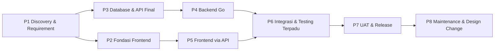
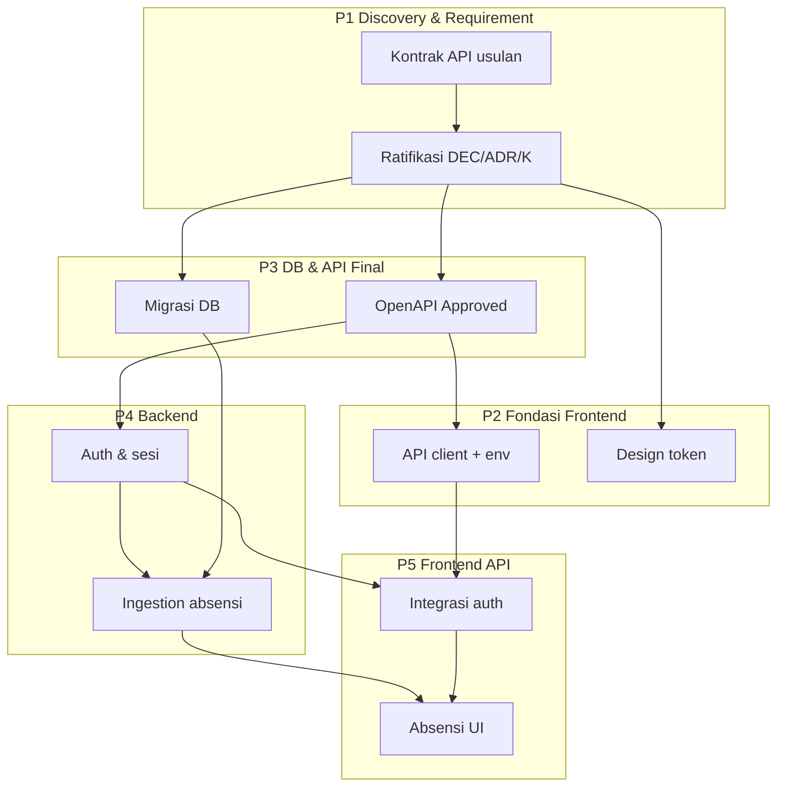

# 04 — WBS: Work Breakdown Structure LIMEN

- **Status dokumen:** Draft untuk ditinjau (Fase F)
- **Versi:** 0.1
- **Tanggal:** 2026-10-11
- **Dokumen terkait:** [00-project-audit.md](./00-project-audit.md) · [01-project-overview.md](./01-project-overview.md) · [02-prd.md](./02-prd.md) · [03-srs.md](./03-srs.md) · [05-sdd.md](./05-sdd.md) · [06-api-documentation.md](./06-api-documentation.md) · [07-uat-checklist.md](./07-uat-checklist.md) · [08-design-change-backup-plan.md](./08-design-change-backup-plan.md) · [09-decision-log.md](./09-decision-log.md) · [10-glossary.md](./10-glossary.md) · [openapi.yaml](./openapi.yaml)

## 1. Cara Membaca Dokumen

- **ID pekerjaan:** `WBS-<Fase>-<nomor>` (mis. `WBS-P4-05`).
- **Pemilik:** `Frontend`, `Backend`, `UI/UX`, atau `Bersama` (pekerjaan bersama dua tim atau lebih).
- **Prioritas:** MoSCoW (`Must` / `Should` / `Could`) mengikuti [02-prd.md](./02-prd.md) dan [03-srs.md](./03-srs.md).
- **Status pekerjaan:** `Selesai` (deliverable sudah ada dan dapat diverifikasi), `Berjalan`, `Belum`. Status ini bukan klaim bahwa pengujian telah dijalankan.
- **Definition of Done (DoD):** kondisi yang harus terpenuhi agar pekerjaan dianggap selesai, dapat diverifikasi, dan dapat diperiksa silang dengan acceptance criteria di [03-srs.md](./03-srs.md) serta test case di [07-uat-checklist.md](./07-uat-checklist.md).

> **Tidak ada timeline pada dokumen ini.** Durasi/deadline **tidak** ditetapkan karena belum didasari kesepakatan stakeholder. Urutan kerja disusun berdasarkan **dependensi** dan **prioritas**, bukan kalender. Bila estimasi diperlukan, buat sebagai asumsi eksplisit yang **belum dikomitmenkan**.

## 2. Gambaran Fase

| Fase | Nama | Deliverable utama | Status | Dependensi |
| --- | --- | --- | --- | --- |
| P1 | Discovery & Requirement Analysis | Audit, PRD, SRS, SDD, kontrak API usulan, ratifikasi keputusan | Sebagian **Selesai** (audit, PRD, SRS, SDD, API draft); ratifikasi **Belum** | — |
| P2 | Perbaikan Fondasi Frontend | Routing/guard, API client, state pattern, konsolidasi kode, design token | Belum | P1 (kontrak API), baseline desain (DEC-14) |
| P3 | Perancangan Database & API Final | Skema PostgreSQL + migrasi terverifikasi backend, kontrak OpenAPI **Approved** | Belum | P1-06, SDD §15–16 |
| P4 | Implementasi Backend (Go) | Backend lengkap per modul + test | Belum | P3 |
| P5 | Implementasi Frontend (integrasi API) | Modul frontend terhubung API + test FE | Belum | P2, P3, giliran P4 per modul |
| P6 | Integrasi & Testing Terpadu | Alur ujung-ke-ujung berjalan, NFR terukur | Belum | P4, P5 |
| P7 | UAT & Release | Hasil [07-uat-checklist.md](./07-uat-checklist.md), Go/No-Go, rilis | Belum | P6 |
| P8 | Maintenance & Design Change | Proses [08-design-change-backup-plan.md](./08-design-change-backup-plan.md) berjalan, regression test per rilis | Belum | P7 |

## 3. Fase P1 — Discovery & Requirement Analysis

Sejumlah deliverable fase ini **sudah ada** dan menjadi dasar seluruh fasen lain. Item yang tersisa (ratifikasi) **belum** dikerjakan dan wajib dikonfirmasi stakeholder/tim.

| ID | Pekerjaan | Pemilik | Prioritas | Deliverable | Dependensi | Definition of Done | Catatan / Risiko |
| --- | --- | --- | --- | --- | --- | --- | --- |
| WBS-P1-01 | Audit & analisis repository | Bersama | Must | [00-project-audit.md](./00-project-audit.md) | — | Setiap temuan punya bukti `file:line`; fakta/usulan/asumsi dipisah. | Selesai. Status temuan `Verified` tidak berarti kode diperbaiki. |
| WBS-P1-02 | Susun PRD | Bersama | Must | [02-prd.md](./02-prd.md) | WBS-P1-01 | Fitur berlabel (F)/(I)/(P)/(A); prioritas MoSCoW; acceptance criteria produk `AC-P-*`. | Selesai. Fitur dari UI tanpa konfirmasi diberi label (I)/(P). |
| WBS-P1-03 | Susun SRS | Bersama | Must | [03-srs.md](./03-srs.md) | WBS-P1-02 | Setiap modul punya `FR-*`; NFR/BR/AC terdefinisi; traceability PRD→SRS. | Selesai. Status Confirmed/Proposed terpisah; tidak ada nilai `TBD` yang dikarang. |
| WBS-P1-04 | Susun SDD (arsitektur FE/BE/DB) | Bersama | Must | [05-sdd.md](./05-sdd.md) | WBS-P1-03 | Arsitektur FE, backend Go, PostgreSQL, autentikasi, integrasi terdokumentasi; ADR dirujuk ke [09-decision-log.md](./09-decision-log.md). | Selesai. Skema DB masih konseptual. |
| WBS-P1-05 | Susun kontrak API usulan | Bersama | Must | [06-api-documentation.md](./06-api-documentation.md) + [openapi.yaml](./openapi.yaml) | WBS-P1-04 | Setiap endpoint `API-*` dipetakan ke requirement; seluruh status endpoint `Proposed`. | Selesai. **Belum disetujui**. |
| WBS-P1-06 | Ratifikasi keputusan bisnis & arsitektur | Bersama | Must | [09-decision-log.md](./09-decision-log.md) dan [03-srs.md](./03-srs.md) diperbarui | WBS-P1-02/03/05 | Setiap `DEC-*`/`ADR-*`/keputusan K-01..K-14 di [06-api-documentation.md](./06-api-documentation.md#24-keputusan-yang-wajib-dibahas-dengan-tim-backend) memiliki status final (`Accepted`/`Rejected`/`Amended`) atau `TBD` beserta pemilik keputusan; tidak ada keputusan dianggap final tanpa persetujuan. | Pemblokir Fase P3/P4. |
| WBS-P1-07 | Tunjuk pemilik desain & tetapkan baseline desain resmi | UI/UX | Must | Baseline desain berversi + tautan desain di [08-design-change-backup-plan.md](./08-design-change-backup-plan.md) | WBS-P1-06, DEC-14 | Versi/tanggal desain acuan tercatat; design token disetujui; SDD-OI-04 tertutup. | **Saat ini `TBD`** (organisasi). |
| WBS-P1-08 | Rincikan aturan absensi yang masih `TBD` | Bersama | Must | Keputusan BR-07, BR-09, DEC-09, FR-KORESI-002 ditutup | WBS-P1-06 | Setiap aturan punya dasar & pemilik keputusan; tanpa nilai yang dikarang. | Menyentuh data & approval, wajib stakeholder. |
| WBS-P1-09 | Tetapkan mekanisme integrasi perangkat IoT | Bersama | Must | Protokol ingestion + kredensial device final (DEC-04, SDD-OI-02, K-10) | WBS-P1-06 | Format `{device_id, identifier, timestamp, event_type}` dikonfirmasi; kredensial device & allowlist diterapkan. | Vendor/perangkat masih `TBD` (SDD-OI-02). |

## 4. Fase P2 — Perbaikan Fondasi Frontend

Bersumber dari audit ([00-project-audit.md](./00-project-audit.md)) dan keputusan ADR-005/008/009 di [09-decision-log.md](./09-decision-log.md). Seluruh pekerjaan di fase ini berumah di `src/` dan **tidak menyentuh backend**.

| ID | Pekerjaan | Pemilik | Prioritas | Deliverable | Dependensi | Definition of Done | Catatan / Risiko |
| --- | --- | --- | --- | --- | --- | --- | --- |
| WBS-P2-01 | Konsolidasi routing + perbaiki bug navigasi | Frontend | Must | `src/app/` (App + router), lazy loading, fix AUD-002/003/005 | Audit findings | Seluruh 62 route masuk struktur terpusat; bug param quiz & impor bank soal hilang; tidak ada alias rusak; `npm run build` hijau. | Menutup AUD-002/003/005. |
| WBS-P2-02 | Autentikasi & sesi di frontend | Frontend | Must | Login/logout nyata, guard UX, penanganan sesi kedaluwarsa (FR-AUTH-001..006) | Kontrak API (WBS-P3-02), backend auth (WBS-P4-02) | `/auth/me` dipakai bootstrap; 401 → redirect login; logout mengakhiri sesi. Guard hanyalah UX (ADR-004). | Menutup AUD-001. Otorisasi tetap di backend. |
| WBS-P2-03 | Lapisan API client + konfigurasi env | Frontend | Must | `src/shared/api/`, `src/config/env.ts` | Kontrak API (WBS-P3-02) | Komponen tidak memanggil `fetch` langsung; error mapping memakai envelope API (§2.5 di 06) | Menutup AUD-004. |
| WBS-P2-04 | Pola state loading/error/empty + ErrorBoundary | Frontend | Must | Komponen state UI konsisten lintas halaman | WBS-P2-03 | Tiap data page punya state loading/error/empty; ErrorBoundary global aktif | Menutup AUD-006. |
| WBS-P2-05 | Model role/permission frontend | Frontend | Should | Tipe & utilitas peran terpusat | WBS-P2-02/03 | Peran berasal dari `/auth/me`; menu per peran (FR-DASH-001) | Menutup AUD-013. |
| WBS-P2-06 | Konsolidasi duplikasi & penamaan | Frontend | Should | Modul bersama terparameterisasi; tanpa berkas identik | WBS-P2-01 | MD5 bank soal/rekap/kelas tidak duplikat; typo "Penialaian" diperbaiki dengan kontrol referensi | Menutup AUD-008/009. |
| WBS-P2-07 | Design token terpusat | UI/UX + Frontend | Must | `src/styles/tokens.css` (Tailwind v4 `@theme`) | WBS-P1-07, DEC-14 | Warna/tipografi/spacing/radius bukan hex arbitrary; perubahan desain hanya sentuh token | Menutup AUD-011; ADR-008. |
| WBS-P2-08 | Aksesibilitas dasar | UI/UX + Frontend | Should | `lang="id"`, label, dialog semantik, alt (WCAG 2.1 AA best-effort) | WBS-P2-07 | `index.html` `lang="id"`; tombol ikon berlabel; modal `role="dialog"` + focus | Menutup AUD-012; NFR-USE-002/003. |
| WBS-P2-09 | Kebersihan kode & aset | Frontend | Should | Dead code dihapus, UTF-8 benar, tanpa debug, aturan impor | WBS-P2-01 | `console.log`/`alert` bersih; mojibake hilang; barrel/public API per modul (AUD-015) | Menutup AUD-010/015/016/017/019. |
| WBS-P2-10 | Lengkapi modul Admin frontend | Frontend | Should | Manajemen pengguna, data akademik, presensi & nilai rapor admin berfungsi | WBS-P2-02/03, API-USR/MST/RPT | Fungsi tidak sekadar `console.log`; pencarian & state berfungsi | Menutup AUD-014; FR-ADMIN-001..003. |
| WBS-P2-11 | Unit test frontend | Frontend | Should | Test Vitest + React Testing Library (absensi, auth, komponen kritis) | WBS-P2-03/04 | Runner test terpasang; coverage pada modul kritis; `npm test` hijau | Menutup AUD-007 (bagian FE); NFR-MNT-002. |

## 5. Fase P3 — Perancangan Database & API Final

Mengubah skema konseptual [05-sdd.md](./05-sdd.md) §15–§17 menjadi skema terverifikasi tim backend dan kontrak yang **disetujui**.

| ID | Pekerjaan | Pemilik | Prioritas | Deliverable | Dependensi | Definition of Done | Catatan / Risiko |
| --- | --- | --- | --- | --- | --- | --- | --- |
| WBS-P3-01 | Validasi & implementasi skema PostgreSQL + migrasi | Backend | Must | Migration berversi (expand-contract, forward-only) + seed idempoten | WBS-P1-06, SDD §15–16 | Semua keputusan DB-01, SDD-OI-07/08, DB-04, DR-005, DEC-10 tertutup; migration `up` idempoten & tes migrasi jalan | ADR-013/014/015/016. |
| WBS-P3-02 | Finalisasi kontrak API + OpenAPI | Bersama | Must | `06-api-documentation.md` & `openapi.yaml` berstatus `Approved` | WBS-P1-06, keputusan K-01..K-14 | Seluruh endpoint `Approved`; contoh & tipe selaras; IR-API-004 terpenuhi | Memblokir integrasi FE–BE. |
| WBS-P3-03 | Penetapan tooling backend | Backend | Must | Keputusan framework HTTP, driver, ORM/query generator, tool migrasi | WBS-P1-06 | Keputusan tercatat di `09-decision-log.md`; scaffolding dapat dibuat | Mengisi celah SDD-OI/SDD §11. |

## 6. Fase P4 — Implementasi Backend (Go)

Lewat Fase P4 backend dikerjakan per domain. Urutan mengikuti **dependensi data**: auth sebelum domain lain; absensi inti sebelum modul pendukung. DoD umum tiap modul: endpoint sesuai kontrak `Approved`, kesalahan memakai envelope (§2.5 di 06), otorisasi divalidasi backend (NFR-SEC-002), `go test` hijau.

| ID | Pekerjaan | Pemilik | Prioritas | Deliverable | Dependensi | Definition of Done (khusus) | Catatan / Risiko |
| --- | --- | --- | --- | --- | --- | --- | --- |
| WBS-P4-01 | Scaffold backend & platform | Backend | Must | `cmd/server/main.go`, `internal/{config,http,platform,device,...}`, logger terstruktur, TZ=Asia/Jakarta | WBS-P3-03 | Struktur ADR-006; config via env; `request_id` di log | WIB (ADR-011). |
| WBS-P4-02 | Autentikasi & sesi | Backend | Must | API-AUTH-001/002/003/004 | WBS-P4-01 | Argon2id, session cookie HttpOnly/Secure/SameSite + CSRF, rate limit login; reset mencabut sesi (DEC-05) | Menutup FR-AUTH-001..006; NFR-SEC-003..005. |
| WBS-P4-03 | Otorisasi & batas data per peran | Backend | Must | Middleware RBAC + filter cakupan data | WBS-P4-02 | BR-14/DEC-07 diterapkan pada semua endpoint terproteksi; 403/404 tanpa bocor detail | ADR-004. |
| WBS-P4-04 | Pengguna & data master | Backend | Must | API-USR-* dan API-MST-* (kelas, mapel, penugasan, siswa) | WBS-P4-02/03 | Manajemen peran/status; profil siswa/guru (ADR-012); K-02/K-03 tertutup | Menutup FR-ADMIN-001/002. |
| WBS-P4-05 | Absensi: ingestion & agregasi harian | Backend | Must | API-ABS-001 + proyeksi `attendance_records` | WBS-P4-02/03 | Idempoten `(device,identifier,timestamp,type)`; satu absen masuk + satu absen pulang per subjek/hari; banyak alat tak menduplikasi; `attendance_date` WIB | Menutup FR-ABS-001/005..008/011/012; ADR-014. |
| WBS-P4-06 | Absensi: status manual & pengaturan sekolah | Backend | Must | API-ABS-004, API-SET-001/002 | WBS-P4-04/05 | `409` bila sudah ada rekaman device; jam masuk konfigurabel; K-04/K-11 tertutup | Menutup FR-ABS-002/010. |
| WBS-P4-07 | Koreksi absensi & persetujuan | Backend | Should | API-ABS-005..008 + `audit_logs` | WBS-P4-05/06 | Koreksi pending tidak mengubah rekap resmi; transaksi kunci record → update → audit (DEC-03, BR-07) | Menutup FR-ABS-004; ADR-016. |
| WBS-P4-08 | Rekap & rapor | Backend | Should | API-RPT-001/002/003 | WBS-P4-05/06 | Hanya rekaman resmi yang dihitung; filter periode/kelas benar | Menutup FR-REKAP-001/002, FR-RAPOT-001/002. |
| WBS-P4-09 | Jadwal | Backend | Should | API-JWL-001..004 | WBS-P4-04 | Validasi `start_time<end_time`; K-05 tertutup | Menutup FR-JADWAL-001. |
| WBS-P4-10 | Quiz, bank soal, koreksi jawaban | Backend | Should | API-QZ-*, API-BNK-*, API-KOR-001 | WBS-P4-02/03 | Kunci jawaban tidak dikirim ke siswa; K-06/K-07 tertutup | Menutup FR-QUIZ-*, FR-BANK-*, FR-KORESI-001. |
| WBS-P4-11 | Tugas & penilaian (termasuk remedial) | Backend | Should | API-TGS-*, API-NIL-* | WBS-P4-04 | `kkm` konfigurabel; remedial mengikuti DEC-09 setelah FR-KORESI-002 dirinci | Menutup FR-TUGAS-001, FR-NILAI-001. |
| WBS-P4-12 | Konseling | Backend | Should | API-KSL-001..004 | WBS-P4-04 | Catatan & tindak lanjut tersimpan + audit | Menutup FR-KONSELING-001/002. |
| WBS-P4-13 | Minat bakat & passing grade | Backend | Could | API-MB-001/002, API-PG-001/002 | WBS-P4-04 | Data referensi passing grade dikelola Admin (DEC-10) | Menutup FR-MB-*, FR-PG-*. |
| WBS-P4-14 | Notifikasi in-app | Backend | Could | API-NTF-001/002 | WBS-P4-05..07 | Status baca tersimpan; source event terdefinisi (K-13) | Menutup FR-NOTIF-001; DEC-12. |
| WBS-P4-15 | Test backend & kontrak | Backend | Must | `go test` service/repo + test kontrak vs OpenAPI | WBS-P4-02..14 | Alur absensi AC-03..AC-13 tercakup; kontrak test hijau | Menutup NFR-MNT-002 (bagian BE). |

## 7. Fase P5 — Implementasi Frontend terhubung API

Memakai [06-api-documentation.md](./06-api-documentation.md) sebagai batas integrasi. Pekerjaan per modul sejajar dengan P4; DoD umum: halaman memakai hook/api layer (bukan `fetch` langsung), state loading/empty/error konsisten (WBS-P2-04), dan source of truth data = API.

| ID | Pekerjaan | Pemilik | Prioritas | Deliverable | Dependensi | Definition of Done (khusus) | Catatan / Risiko |
| --- | --- | --- | --- | --- | --- | --- | --- |
| WBS-P5-01 | Integrasi autentikasi (login/logout/me) | Frontend | Must | Login & sesi terhubung API-AUTH-* | WBS-P2-02/03, WBS-P4-02 | Login sukses/gagal tampil benar; redirect pasca login sesuai peran | Menutup FR-AUTH-001..006. |
| WBS-P5-02 | Dashboard per peran | Frontend | Must | Dashboard dari `/auth/me` + data modul | WBS-P5-01 | Menu per peran; navigasi berfungsi (FR-DASH-001) | Menutup AUD-013. |
| WBS-P5-03 | Absensi guru mapel/wali/admin | Frontend | Must | Daftar/penetapan status/rekap, tanda merah, absensi guru | WBS-P5-01, WBS-P4-05/06 | Status tersimpan; nama merah sesuai `checkInAt:null` (FR-ABS-002/003/009/013) | Inti absensi (GOAL-01..03). |
| WBS-P5-04 | Jadwal | Frontend | Should | Halaman jadwal via API-JWL-001 | WBS-P5-01, WBS-P4-09 | Filter kelas/periode berfungsi (FR-JADWAL-001) | — |
| WBS-P5-05 | Quiz, latihan, bank soal | Frontend | Should | Kerjakan/detail/riwayat quiz; daftar latihan; kelola soal | WBS-P5-01, WBS-P4-10 | Tanpa kunci jawaban bocor ke siswa; autosave berfungsi (FR-QUIZ-*, FR-LATIHAN-001, FR-BANK-*) | — |
| WBS-P5-06 | Tugas, penilaian, koreksi, remedial | Frontend | Should | Kelola tugas/nilai; koreksi esai; remedial | WBS-P5-01, WBS-P4-11 | Nilai tersimpan; remedial mengikuti DEC-09 (FR-TUGAS-001, FR-NILAI-001, FR-KORESI-001/002) | — |
| WBS-P5-07 | Rekap & rapor | Frontend | Should | Rekap absensi/nilai; rapor & detail mapel | WBS-P5-01, WBS-P4-08 | Filter periode/kelas; sesuai data resmi (FR-REKAP-*, FR-RAPOT-*) | — |
| WBS-P5-08 | Konseling | Frontend | Should | Daftar/catat/tindak lanjut konseling | WBS-P5-01, WBS-P4-12 | Catatan & tindak lanjut tampil (FR-KONSELING-*) | — |
| WBS-P5-09 | Minat bakat & passing grade | Frontend | Could | Hasil minat bakat, target jurusan, informasi passing grade | WBS-P5-01, WBS-P4-13 | Data tampil sesuai API (FR-MB-*, FR-PG-*) | — |
| WBS-P5-10 | Notifikasi | Frontend | Could | Daftar & tandai baca | WBS-P5-01, WBS-P4-14 | Status baca tersimpan (FR-NOTIF-001) | — |
| WBS-P5-11 | Admin frontend lengkap | Frontend | Must | Kelola pengguna, data akademik, presensi & nilai rapor via API-USR/MST/RPT | WBS-P5-01, WBS-P4-04/05/08 | Aksi tersimpan backend, bukan `console.log` (FR-ADMIN-001..003) | Melengkapi AUD-014 (WBS-P2-10 bila backend belum ada). |

## 8. Fase P6 — Integrasi & Testing Terpadu

| ID | Pekerjaan | Pemilik | Prioritas | Deliverable | Dependensi | Definition of Done | Catatan / Risiko |
| --- | --- | --- | --- | --- | --- | --- | --- |
| WBS-P6-01 | Uji alur ujung ke ujung (absensi inti) | Bersama | Must | Kasus AC-01..AC-13 teruji end-to-end | WBS-P4-05..07, WBS-P5-01/03 | Tap IoT → status → rekap → koreksi → persetujuan berjalan di lingkungan terpadu | Kasus uji utama (SDD §9.4). |
| WBS-P6-02 | Penanganan sesi expired & error terpadu | Bersama | Must | 401 `SESSION_EXPIRED` → redirect; envelope error konsisten | WBS-P5-01, WBS-P4-02 | FR-AUTH-005 & IR-API-002 terpenuhi | — |
| WBS-P6-03 | Align mock ↔ real (test kontrak) | Bersama | Must | Mock FE tidak lagi divergen dari kontrak | WBS-P3-02, WBS-P5-01 | Setiap `API-*` teruji via kontrak; tiada field tak deklarasi | ADR-002. |
| WBS-P6-04 | E2E otomatis (Playwright) | Bersama | Could | Test E2E alur kritis | WBS-P6-01 | Alur absensi & auth dalam CI | NFR-MNT-002 (opsional). |
| WBS-P6-05 | Verifikasi NFR | Bersama | Should | Laporan NFR-PERF-001/REL-001/USE-003/COM-001 | WBS-P6-01 | Target DEC-06 **yang sudah diratifikasi** terukur; hasil dicatat | Target masih Proposed (DEC-06). |

## 9. Fase P7 — UAT & Release

| ID | Pekerjaan | Pemilik | Prioritas | Deliverable | Dependensi | Definition of Done | Catatan / Risiko |
| --- | --- | --- | --- | --- | --- | --- | --- |
| WBS-P7-01 | Eksekusi UAT | Bersama | Must | [07-uat-checklist.md](./07-uat-checklist.md) terisi: status `Pass`/`Fail`/dst | WBS-P6-01 | Skenario `Blocked`/`Not Run` tidak dihitung lulus; bukti & severity dicatat | Tidak mengklaim jalankan bila tidak dijalankan. |
| WBS-P7-02 | Release acceptance & Go/No-Go | Bersama | Must | Keputusan Go/No-Go tercatat (dasar: kriteria §9 di 07) | WBS-P7-01 | Kriteria Must semua `Pass`; tanpa Blocker/Critical | Diputuskan stakeholder. |
| WBS-P7-03 | Deployment & runbook rollback | Bersama | Must | Prosedur deploy + rollback di [08-design-change-backup-plan.md](./08-design-change-backup-plan.md) §E teruji | WBS-P7-02 | Rollback latihan terdokumentasi & terjadwal | Data-loss harus cegah (migrasi expand-contract). |
| WBS-P7-04 | Baseline rilis v1.0 | Bersama | Should | Tag rilis + desain baseline stabil | WBS-P7-02 | Tag & checkpoint tersimpan (lihat 08 §D) | — |
| WBS-P7-05 | Penetapan monitoring & observability | Bersama | Should | Dashboard log/audit/availabilitas | WBS-P7-03 | NFR-OBS-001 tercatat; retensi log sesuai DEC-11 | Angka retensi masih Proposed. |

## 10. Fase P8 — Maintenance & Design Change

| ID | Pekerjaan | Pemilik | Prioritas | Deliverable | Dependensi | Definition of Done | Catatan / Risiko |
| --- | --- | --- | --- | --- | --- | --- | --- |
| WBS-P8-01 | Operasionalisasi change process desain | Bersama | Should | Alur DCR-Workflow di [08-design-change-backup-plan.md](./08-design-change-backup-plan.md) berjalan | WBS-P7-04 | Setiap DCR memiliki ID, impact analysis, persetujuan & baseline baru | Mitigasi RSK-004. |
| WBS-P8-02 | Regression testing per rilis | Bersama | Should | Set hasil regression di [07-uat-checklist.md](./07-uat-checklist.md) | WBS-P8-01 | Regresi fungsi inti (absensi/auth) hijau sebelum rilis; visual regression bila proporsional | Menutup AUD-007 berkelanjutan. |
| WBS-P8-03 | Pemeliharaan dokumen & kontrak | Bersama | Should | Docs & OpenAPI sinkron dengan implementasi | WBS-P8-01 | Perubahan API lewat PR ke spec (SDD §6); tidak ada endpoint `Approved` tanpa dokumen | ADR-002. |

## 11. Peta Dependensi Antarfase

## 12. Traceability ke Dokumen Lain

Pemetaan lintas dokumen (`PRD → SRS → SDD → API → UAT → WBS`) dipertahankan di [07-uat-checklist.md](./07-uat-checklist.md) §10. Ringkasan penjagaan konsistensi:

- Setiap `FR-*`/`NFR-*` di [03-srs.md](./03-srs.md) dipetakan ke komponen [05-sdd.md](./05-sdd.md) (§12 SDD), endpoint [06-api-documentation.md](./06-api-documentation.md) (§22 API), test case [07-uat-checklist.md](./07-uat-checklist.md), dan pekerjaan WBS di atas.
- Requirement **jarang** membutuhkan WBS sendiri-sendiri: banyak `FR-*` ditutup oleh satu deliverable WBS (mis. seluruh absensi inti oleh WBS-P4-05/06 + WBS-P5-03). Ini disengaja agar WBS tidak terfragmentasi.
- Keputusan yang belum final tetap `Proposed`/`TBD` dan tidak menjadi landasan target jadwal.
- Tidak ada pekerjaan pada dokumen ini yang mengubah kode aplikasi; pekerjaan kode dimulai dari Fase P2 ke atas sesuai [00-project-audit.md](./00-project-audit.md).

## 13. Ringkasan Pelembur Pemblokir Utama

1. **Ratifikasi keputusan (WBS-P1-06)** — tanpa ini, skema & kontrak final terhambat.
2. **Baseline desain resmi (WBS-P1-07, DEC-14)** — tanpa ini, perubahan visual berulang (RSK-004).
3. **Kontrak API `Approved` (WBS-P3-02)** — pengunci integrasi FE/BE (IR-API-004, RSK-003).
4. **Integrasi IoT vendor (WBS-P1-09, SDD-OI-02)** — inti absensi berisiko tanpa protokol final (RSK-006).