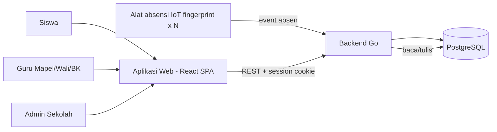
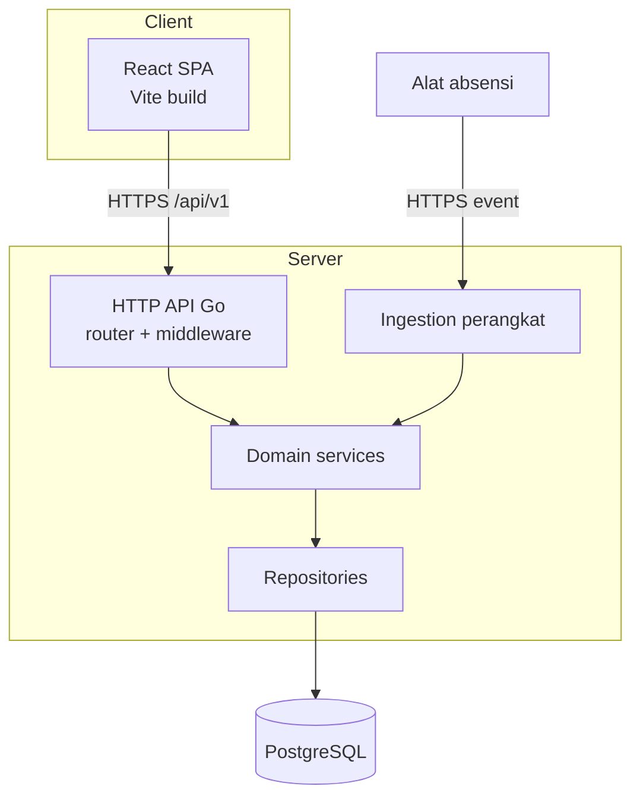
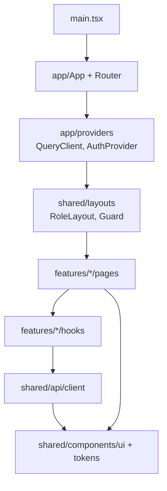
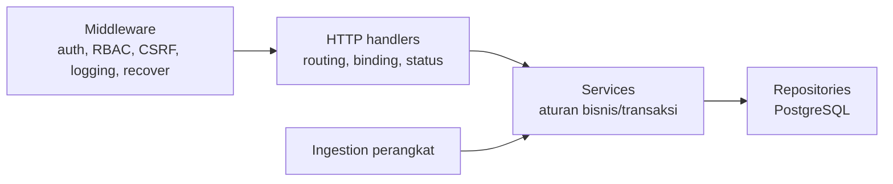
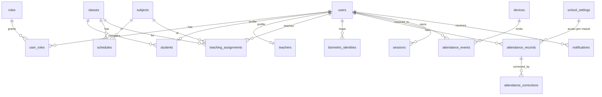
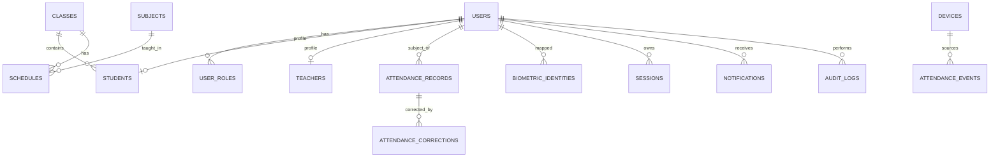

# 05 — SDD: System Design Document LIMEN

- **Status dokumen:** Draft untuk ditinjau (Fase 4A)
- **Versi:** 0.1
- **Tanggal:** 2026-10-11
- **Dokumen terkait:** [00-project-audit.md](./00-project-audit.md) · [01-project-overview.md](./01-project-overview.md) · [02-prd.md](./02-prd.md) · [03-srs.md](./03-srs.md) · [09-decision-log.md](./09-decision-log.md)

## Konvensi status

- **Confirmed** — fakta dari stakeholder atau kode aktual (lihat SRS/PRD).
- **Proposed** — rekomendasi desain, belum disetujui; perlu ratifikasi.
- Angka/opsi yang belum pasti ditandai `TBD`.

> Tahap 4A tidak menulis kode dan tidak membuat migrasi database. Semua contoh skema bersifat konseptual.

## 1. Architecture Overview

### 1.1 Konteks sistem



- **Frontend**: React 19 + TypeScript + Vite SPA yang *sudah ada* (Confirmed).
- **Backend**: Go (Proposed, dari rencana proyek).
- **Database**: PostgreSQL (Proposed, dari rencana proyek).
- **Perangkat IoT**: ≥ 1 alat; siswa/guru bebas memilih alat (Confirmed, BR-11/BR-13).

### 1.2 Container/komponen



### 1.3 Prinsip arsitektur

| Prinsip | Status | Alasan |
| --- | --- | --- |
| SPA terpisah dari backend, komunikasi REST/JSON | Proposed | Frontend sudah SPA (Confirmed); REST paling sederhana untuk CRUD. |
| Otorisasi di backend, bukan di frontend | Confirmed (SRS NFR-SEC-002) | Route guard hanya UX; keamanan wajib di server. |
| Session berbasis cookie server-side | Proposed (DEC-05) | Aplikasi web monolitik; revokasi mudah saat Admin reset password. JWT **tidak** diwajibkan. |
| Feature-first modular di frontend | Proposed | Repo aktual sudah dominan per-fitur; memperkuat batas modul. |
| Backend berlapis (handler→service→repository) | Proposed | Memisahkan transport, domain, persistensi. |
| Zona waktu server = Asia/Jakarta | Confirmed (BR-12) | Penentuan keterlambatan butuh WIB. |

## 2. Arsitektur Frontend (React + TypeScript + Vite)

### 2.1 Kondisi aktual (Confirmed dari audit)

- Bundler **Vite 8**, React **19**, TS ~6.0, Tailwind **v4** (`@tailwindcss/vite`), React Router DOM **7**.
- Routing **inline** di `src/App.tsx` (±240 baris, 62 route), tanpa layout, tanpa lazy, tanpa guard (AUD-001).
- Tidak ada API client, tidak ada state library, tidak ada `.env` (AUD-005/006).
- `src/` berisi `components/`, `features/`, `pages/`, `types/`, `data/`, `assets/`.
- Bug terverifikasi: import ganda/salah (`App.tsx:42-44`), param `:quiz_id` vs `useParams().id` (`Quiz.tsx:66`), route `/guru/ujian/bankSoal` salah memuat komponen LatihanSoal, `Login.tsx` tanpa autentikasi.
- Duplikasi berkas identik: `banksoal` LatihanSoal≡Ujian, `KelasCard`, `RekapNilaiSiswa` (AUD-008/009).
- `index.html` `lang="en"` (bertentangan dengan NFR-USE-002 `id`).

### 2.2 Target arsitektur frontend



Prinsip:
- **Routing terpusat** di `app/` (bukan 62 import inline di `App.tsx`); route didefinisikan per-modul dan di-*compose*.
- **Lazy loading** per modul fitur + `Suspense` (perbaikan performa, Proposed).
- **Lapisan API** tunggal; komponen tidak memanggil `fetch` langsung.
- **Server-state** dikelola library khusus (mis. TanStack Query) — Proposed; **local state** tetap `useState`/`useReducer`. Menghindari global store berat.

## 3. Rekomendasi Struktur Folder Frontend

### 3.1 Pemetaan aktual → target

| Aktual | Target | Catatan |
| --- | --- | --- |
| `src/App.tsx` (routing inline) | `src/app/App.tsx`, `src/app/router.tsx` | Pisahkan definisi route; bug import diperbaiki (AUD-002). |
| `src/features/*` | `src/features/<domain>/` | Pertahankan; standarkan sub-folder `pages/ components/ hooks/ api/ model/`. |
| `src/components/*` | `src/shared/components/` | Komponen lintas fitur; hapus duplikat (AUD-008/009). |
| `src/pages/NotFound.tsx` | `src/shared/pages/NotFound.tsx` | Halaman lintas fitur. |
| `src/types/jadwal.ts` | `src/features/jadwal/model/` + `src/shared/types/` | Tipe dekat domain; tipe umum di shared. |
| `src/data/jadwal` | `src/features/jadwal/api/` (mock) — dihapus saat integrasi API | Data mock dipensiunkan. |
| (tidak ada) | `src/app/providers/` | QueryClient, Auth/Session provider. |
| (tidak ada) | `src/shared/api/` | `client.ts` (wrapper fetch), `errors.ts`. |
| (tidak ada) | `src/shared/layouts/` | Layout per peran + guard UX. |
| (tidak ada) | `src/config/env.ts` | Baca `import.meta.env.VITE_*`. |
| (tidak ada) | `src/styles/tokens.css` | Design token (Tailwind v4 `@theme`). |

### 3.2 Struktur target (konseptual)

```
src/
  app/
    App.tsx            # compose router + providers
    router.tsx         # definisi route per modul
    providers/         # QueryClient, SessionProvider
  shared/
    api/               # client.ts, errors.ts, queryKeys.ts
    components/        # ui/ (Button, Badge, Card), layout/
    layouts/           # RoleLayout, ProtectedLayout (UX guard)
    hooks/             # useDebounce, useSession
    types/             # tipe lintas domain
    utils/
  features/
    absensi/           # pages/, components/, hooks/, api/, model/
    auth/  dashboard/  jadwal/  nilai/  quiz/  konseling/  minat-bakat/  passing-grade/  notifikasi/  admin/
  config/env.ts
  styles/tokens.css
  main.tsx
```

> Nama domain target disarankan menyeragamkan `guru`, `guruMapel`, `guruWali`, `guruBK` menjadi domain berbasis **kapabilitas** (mis. `absensi`, `penilaian`, `konseling`) dengan varian per peran, agar tidak ada logika ganda. Ini refactor bertahap (Proposed), bukan wajib untuk MVP.

## 4. Batas Tanggung Jawab (Frontend)

| Lapisan | Tanggung jawab | Tidak boleh |
| --- | --- | --- |
| `app/` | Bootstrap, provider, definisi router, guard UX | Berisi logika domain |
| `features/<x>/pages` | Komposisi halaman, konsumsi hook | Panggil `fetch` langsung; simpan aturan otorisasi |
| `features/<x>/components` | UI spesifik fitur | Dipakai lintas fitur tanpa diangkat ke shared |
| `features/<x>/hooks` | Orkestrasi data/aksi fitur | Akses DOM mentah |
| `features/<x>/api` | Query/mutation ke endpoint | Format pesan error ad-hoc |
| `shared/api/client` | Wrapper HTTP tunggal, cookie, CSRF header, error mapping | Menyimpan state domain |
| `shared/components/ui` | Komponen presentasional tanpa data | Memanggil API |
| `shared/types` | Tipe lintas domain | Aturan bisnis |
| `config/env.ts` | Sumber tunggal konfigurasi klien | Menyimpan rahasia |
| state | Server-state via query lib; local via hooks | Duplikasi server-state ke store global |

## 5. Arsitektur Backend Go (Konseptual)

### 5.1 Lapisan



- **Handler**: validasi input, panggil service, bentuk respons. Tidak berisi aturan bisnis.
- **Service**: aturan absensi (keterlambatan WIB, koreksi+audit, status), orkestrasi transaksi.
- **Repository**: akses PostgreSQL; tanpa aturan domain.
- **Platform**: clock/timezone (Asia/Jakarta), logger, config, DB pool.

### 5.2 Paket (konseptual)

```
cmd/server/main.go
internal/
  config/        # env parsing
  http/          # router.go, middleware/, handlers/, dto/
  domain/        # absensi, auth, user, nilai, ... (entity + interface)
  service/       # absenservice, authservice, ...
  repository/    # postgres/...
  device/        # ingestion absensi
  platform/      # clock, logger, db, id
```

### 5.3 Domain absensi (konseptual)

- Entity `AttendanceEvent` (device_id, identifier, timestamp, type: masuk/pulang) — dari ingestion.
- Entity `AttendanceRecord` (subject: siswa/guru, tanggal, status: Hadir/Terlambat/Izin/Sakit/Alpa, sumber, device_id) — hasil agregasi harian.
- Aturan: jam masuk tunggal dari konfigurasi Admin; keterlambatan memakai **WIB**; satu absen masuk + satu absen pulang per subjek/hari (NFR-DATA-001); event dari beberapa alat tidak menduplikasi.
- Idempotensi ingestion: kunci unik per `(device_id, identifier, timestamp)` untuk menahan kirim ulang.
- **Bukan** mengelola penggajian (Confirmed out-of-scope, DEC-15).

> Skema tabel rinci dan migrasi **tidak** ditulis pada tahap ini (menunggu Fase 4B/ratifikasi).

## 6. Kontrak Komunikasi Antartim

- **Contract-first**: satu berkas **OpenAPI 3.x** di repo sebagai sumber kebenaran; frontend meng-*generate* tipe, backend memakai untuk validasi. (Proposed)
- **Versioning**: prefix `/api/v1`. (Proposed)
- **Auth**: cookie sesi (HttpOnly, Secure, SameSite=Lax) + header CSRF untuk mutasi. (Proposed, DEC-05)
- **Format error** seragam: `{ "code": string, "message": string, "details"?: unknown }`. (Proposed)
- **Waktu**: ISO-8601 dengan offset; domain keterlambatan memakai WIB. (Confirmed untuk WIB)
- **Pagination**: `?page=&pageSize=` dengan respons `{ items, page, pageSize, total }`. (Proposed)
- **Alur handoff**: perubahan API lewat PR ke spec OpenAPI + contoh mock sebelum implementasi. (Proposed)
- **Definisi selesai (DoD) integrasi**: endpoint sesuai spec, error format sesuai, tercakup test kontrak. (Proposed)

## 7. Autentikasi, Session Management, dan Authorization

### 7.1 Autentikasi (Proposed, DEC-05)

- Login email+password (Confirmed, BR-01); password di-hash **Argon2id** (Proposed).
- Sesi server-side: cookie HttpOnly + Secure + SameSite=Lax; idle 30 menit, absolut 12 jam (Proposed).
- Reset password oleh Admin (Confirmed, BR-02) → mencabut sesi aktif pengguna tersebut.
- Rate limiting login (Proposed).

### 7.2 Alternatif session vs token

| Opsi | Kelebihan | Kekurangan | Rekomendasi |
| --- | --- | --- | --- |
| **Session cookie** (server-side) | Revokasi instan (reset Admin), tak ada token di JS, sederhana untuk web | Butuh store sesi & proteksi CSRF | **Dipilih** (Proposed) |
| JWT stateless | Skala horizontal mudah, tanpa store | Revokasi sulit, rawan salah kelola; tak dibutuhkan di skala ini | Tidak dipakai |
| Hybrid | Fleksibel | Kompleksitas ganda | Tidak |

> JWT **tidak** dijadikan kewajiban. Store sesi disarankan tabel PostgreSQL (tanpa Redis) sampai skala menuntut sebaliknya (Proposed, `TBD` bila perlu Redis).

### 7.3 Otorisasi (Confirmed prinsip; matriks Proposed, BR-14/DEC-07)

- **Wajib divalidasi backend** pada setiap permintaan terproteksi (SRS NFR-SEC-002).
- Route guard frontend = **UX saja** (mengarahkan/ menyembunyikan), **bukan** pengganti otorisasi.

| Peran | Akses data (Proposed) |
| --- | --- |
| Siswa | Data miliknya sendiri |
| Guru Mapel | Kelas/mapel yang diampu |
| Guru Wali | Kelas perwalian |
| Guru BK | Semua siswa (konseling) |
| Admin Sekolah | Semua data dalam sekolah; kelola user & konfigurasi; meninjau absensi guru |

## 8. Security Considerations

| Area | Kontrol | Status |
| --- | --- | --- |
| Transport | HTTPS wajib | Proposed |
| Sesi | Cookie HttpOnly/Secure/SameSite; rotasi saat login; cabut saat reset password | Proposed |
| CSRF | Token/samesite untuk endpoint mutasi | Proposed |
| Password | Argon2id + kompleksitas `TBD` | Proposed |
| Brute-force | Rate limit login | Proposed |
| Otorisasi | Cek peran per resource di backend | Confirmed |
| Input | Validasi server-side; hindari mass-assignment | Proposed |
| Ingestion perangkat | Kredensial device + allowlist device_id; idempotensi | Proposed |
| Secrets | Tidak di repo; via env/secret manager | Proposed |
| PII | Minimalkan; akses sesuai matriks; log tanpa data sensitif | Proposed |
| Audit | Jejak perubahan absensi/nilai (aktor, waktu, alasan) | Proposed (BR-07) |

## 9. Error Handling, Logging, Konfigurasi, Testing

### 9.1 Error handling
- HTTP status tepat (400/401/403/404/409/422/500); envelope error seragam (§6).
- 401 → frontend arahkan ke login; 403 → pesan akses ditolak (tanpa bocor detail).
- Konflik idempotensi ingestion ditangani sebagai sukses/no-op.

### 9.2 Logging & observability
- Backend: log terstruktur JSON + `request_id`; audit log perubahan absensi/nilai (retensi ≥ 1 tahun, DEC-11).
- Frontend: error boundary + pelaporan error `TBD`.

### 9.3 Konfigurasi
- Frontend: `import.meta.env.VITE_API_BASE_URL` via `src/config/env.ts`; validasi saat start.
- Backend: env vars (DSN, session secret, TZ=Asia/Jakarta, dsb.); contoh `.env.example` (tanpa rahasia nyata).

### 9.4 Testing (Proposed, NFR-MNT-002)
- Frontend: **Vitest** + React Testing Library; uji komponen/hook kritis (absensi, auth).
- Backend: `go test` untuk service & repository; test kontrak API vs OpenAPI.
- E2E (Playwright) prioritas Could.
- Alur absensi (masuk/pulang, terlambat, tanda merah) menjadi kasus uji utama (AC-03..AC-13).

## 10. Strategi Integrasi UI/UX dan Design Tokens

- Baseline desain = implementasi frontend saat ini + token internal (Proposed, DEC-14); pemilik desain resmi `TBD`.
- Token terpusat via Tailwind v4 `@theme` di `src/styles/tokens.css` (warna, tipografi, spacing, radius, state).
- Mobile-first (Confirmed, NFR-USE-001); state loading/empty/error konsisten.
- Aksesibilitas target WCAG 2.1 AA (Proposed, DEC-06); `html lang="id"` (perbaikan `index.html`).
- Ketika aset desain resmi tersedia, hanya token perlu disesuaikan (mengurangi rework).

## 11. Alternatif & Rekomendasi

| Keputusan | Opsi | Rekomendasi | Alasan |
| --- | --- | --- | --- |
| Rendering frontend | SPA (Vite) vs SSR (Next) | **SPA** (Proposed) | Frontend sudah SPA; aplikasi di balik login, tanpa kebutuhan SEO. |
| Komunikasi | REST vs GraphQL | **REST** (Proposed) | CRUD sederhana, tim kecil, tooling umum. |
| Session | Cookie-session vs JWT | **Cookie-session** (Proposed) | Revokasi mudah; JWT tak perlu. |
| State frontend | TanStack Query vs Redux vs tanpa lib | **Query + local state** (Proposed) | Server-state dominan; hindari store berat. |
| Repo | Mono-repo vs repo terpisah | **Mono-repo** (`frontend/`,`backend/`) (Proposed) | Kontrak OpenAPI dekat satu tempat. |
| Session store | PostgreSQL vs Redis | **PostgreSQL** (Proposed) | Skala sekolah; hindari komponen tambahan. |
| Struktur folder FE | Pertahankan `features/` vs reorganisasi besar | **Pertahankan + standarkan** (Proposed) | Repo sudah feature-first; refactor bertahap. |

## 12. Traceability & Konsistensi dengan SRS

| SRS/NFR | Keputusan SDD |
| --- | --- |
| FR-AUTH-001..006 | §7 autentikasi/sesi |
| NFR-SEC-001..005 | §7, §8 |
| BR-12 (WIB) | §1, §5, §9 |
| BR-06/07/10/11/13 | §5 domain absensi |
| NFR-MNT-002 | §9.4 testing |
| NFR-USE-001/002/003 | §2, §10 |
| IR-API-001..003 | §6 |
| IR-SW-001 | §5 ingestion |
| NFR-OBS-001 | §9.2 |

Catatan konsistensi:
- Tidak ada pernyataan yang bertentangan dengan SRS; item `Proposed` di SDD tetap `Proposed` (tidak dinaikkan menjadi final).
- Otorisasi tidak pernah diletakkan pada route guard frontend.

## 13. Open Issues (diperbarui Fase 4B)

| ID | Isu | Status | Terkait |
| --- | --- | --- | --- |
| SDD-OI-01 | Skema PostgreSQL rinci & strategi migrasi | **Dirancang di §15–§17 (draft)** | §15 |
| SDD-OI-02 | Detail autentikasi device ingestion | Terbuka | DEC-04, §15.3 |
| SDD-OI-03 | Pilihan Redis untuk sesi bila skala meningkat | Terbuka | §7.2 |
| SDD-OI-04 | Pemilik desain & tanggal versi acuan UI/UX | Terbuka | DEC-14 |
| SDD-OI-05 | Target volume pengguna untuk sizing NFR | Terbuka | DEC-06 |
| SDD-OI-06 | Strategi pelaporan error frontend | Terbuka | §9.2 |
| SDD-OI-07 | Model identitas: M:N peran vs satu kolom peran | Perlu diputuskan (§18) | §15.3 |
| SDD-OI-08 | Lingkup identitas fingerprint: global vs per-device | Perlu diputuskan (§18) | §15.3 |

## 14. Keputusan yang Dicatat

Rekomendasi arsitektur & data penting dicatat sebagai ADR di [09-decision-log.md](./09-decision-log.md) (ADR-001..ADR-016).

---

## 15. Database Design (PostgreSQL)

> Semua definisi bersifat **konseptual**. Tidak ada SQL migration siap pakai pada tahap ini. Nama tabel/kolom dan tipe adalah **usulan** kecuali ditandai Confirmed (berasal dari requirement tercatat). Tipe `uuid` untuk PK, `timestamptz` untuk waktu, dan `text` untuk label adalah usulan konvensi.

### 15.1 Konvensi

| Aspek | Usulan | Status |
| --- | --- | --- |
| Nama tabel | `snake_case`, jamak (`users`, `attendance_records`) | Proposed |
| Primary key | `id uuid` (default `gen_random_uuid()`) | Proposed |
| Timestamp | `created_at`, `updated_at timestamptz not null default now()` | Proposed |
| Audit jelas | `created_by`, `updated_by` pada entitas yang diedit manusia | Proposed |
| Waktu lokal | Simpan `timestamptz` (UTC internal); `timezone` = `Asia/Jakarta` untuk derivasi & tampilan | Confirmed (BR-12) |
| Enum | Postgres enum untuk himpunan tetap; lookup table untuk peran | Proposed |
| Penghapusan | Soft-delete (`deleted_at`) hanya bila requirement menuntut | TBD |

### 15.2 Entitas Inti & Alasan

| # | Tabel | Alasan keberadaan (dasar) | Status |
| --- | --- | --- | --- |
| 1 | `users` | Identitas & kredensial; login email+password (BR-01, FR-AUTH-001) | Confirmed |
| 2 | `roles` | Daftar 5 peran (PRD 4, DEC-07) | Confirmed (peran); tabel = Proposed |
| 3 | `user_roles` | Satu orang dapat berperan ganda (mis. Guru Mapel + Wali) | Proposed |
| 4 | `students` | Profil siswa + NIS + kelas (DR-002) | Confirmed (kebutuhan) |
| 5 | `teachers` | Profil guru + NIP (DR-002; guru absen, BR-13) | Proposed |
| 6 | `classes` | Kelas & wali kelas (DR-002, FEAT-WALI-01) | Confirmed (kebutuhan) |
| 7 | `subjects` | Mata pelajaran (DR-002) | Confirmed (kebutuhan) |
| 8 | `teaching_assignments` | Menegakkan cakupan Guru Mapel (BR-14/DEC-07) | Proposed |
| 9 | `schedules` | Jadwal pelajaran/ujian/tryout (DR-004, FR-JADWAL-001) | Confirmed (kebutuhan) |
| 10 | `school_settings` | Jam masuk pertama & TZ acuan keterlambatan (FR-ABS-010, DEC-02) | Confirmed |
| 11 | `devices` | Registri ≥1 alat absensi (BR-11, DEC-04) | Confirmed (kebutuhan); skema Proposed |
| 12 | `biometric_identities` | Pemetaan sidik jari → pengguna (FR-ABS-006) | Proposed |
| 13 | `attendance_events` | Event mentah dari alat (masuk/pulang), idempoten (FR-ABS-006, DEC-04) | Proposed |
| 14 | `attendance_records` | Rekaman harian per subjek + status (FR-ABS-001..013, NFR-DATA-001) | Confirmed (kebutuhan) |
| 15 | `attendance_corrections` | Koreksi absensi & persetujuan (FR-ABS-004, DEC-03) | Proposed |
| 16 | `audit_logs` | Jejak perubahan absensi/nilai (BR-09, NFR-OBS-001) | Proposed |
| 17 | `sessions` | Sesi login server-side (ADR-007) | Proposed |
| 18 | `notifications` | Notifikasi in-app (FR-NOTIF-001, DEC-12) | Proposed |

### 15.3 Kolom, PK, FK, Constraint, Index (inti)

**`users`**
| Kolom | Tipe | Null | Constraint |
| --- | --- | --- | --- |
| `id` | uuid | no | PK |
| `email` | text | no | UNIQUE (case-insensitive via `citext` atau `lower()` index) |
| `password_hash` | text | no | — |
| `full_name` | text | no | — |
| `status` | text/enum | no | CHECK in ('active','inactive'); default 'active' |
| `last_login_at` | timestamptz | yes | — |
| `created_at`, `updated_at` | timestamptz | no | default now() |

**`roles`**: `code` (PK, text), `name` (text). Seed: `siswa`, `guru_mapel`, `guru_wali`, `guru_bk`, `admin`.
**`user_roles`**: `user_id` FK→users, `role_code` FK→roles, PK(`user_id`,`role_code`), `granted_at`, `granted_by` FK→users.
> **Trade-off (SDD-OI-07):** M:N mendukung peran ganda (guru Mapel sekaligus Wali) dan menegakkan integritas; alternatif satu kolom `role` di `users` lebih sederhana tetapi tidak mendukung peran ganda. Rekomendasi: **`user_roles`** (Proposed).

**`students`**: `user_id` PK FK→users, `nis` text UNIQUE NOT NULL, `class_id` FK→classes (nullable sampai penempatan), `created_at`, `updated_at`.
**`teachers`**: `user_id` PK FK→users, `nip` text UNIQUE NULL, timestamps.
**`classes`**: `id` PK, `name` text NOT NULL, `level` text null, `homeroom_teacher_user_id` FK→users NULL (guru wali), timestamps. Index `(homeroom_teacher_user_id)`.

**`subjects`**: `id` PK, `code` text UNIQUE, `name` text NOT NULL.
**`teaching_assignments`**: `id` PK, `teacher_user_id` FK→users, `subject_id` FK→subjects, `class_id` FK→classes, UNIQUE(`teacher_user_id`,`subject_id`,`class_id`).

**`schedules`**: `id` PK, `class_id` FK→classes NOT NULL, `subject_id` FK→subjects NOT NULL, `teacher_user_id` FK→users NULL, `day_of_week` smallint CHECK (1..7), `start_time` time, `end_time` time, `kind` text CHECK in ('pelajaran','ujian','tryout'), CHECK(`start_time` < `end_time`). Index: (`class_id`,`day_of_week`).

**`school_settings`** (singleton)
| Kolom | Tipe | Null | Constraint |
| --- | --- | --- | --- |
| `id` | smallint | no | PK, CHECK (`id` = 1) |
| `first_entry_time` | time | no | — |
| `timezone` | text | no | default 'Asia/Jakarta' |
| `late_tolerance_minutes` | int | no | CHECK ≥ 0; default 0 (Proposed) |
| `updated_by` | uuid FK→users | yes | — |
| `updated_at` | timestamptz | no | default now() |

**`devices`**: `id` uuid PK, `name` text NOT NULL, `location` text, `serial` text UNIQUE, `is_active` bool NOT NULL default true, `credential_ref` text (referensi rahasia, bukan nilai), `last_seen_at` timestamptz, `created_at`/`updated_at`.

**`biometric_identities`**: `id` uuid PK, `identifier` text NOT NULL, `subject_user_id` uuid FK→users NOT NULL, `subject_type` enum('student','teacher') NOT NULL, `is_active` bool NOT NULL default true, `created_at`/`updated_at`.
> **Trade-off (SDD-OI-08):** Karena siswa/guru bebas memakai alat mana pun (BR-11), rekomendasi pemetaan **global** dengan UNIQUE(`identifier`) dan `is_active`. Alternatif: pemetaan per-device (UNIQUE(`device_id`,`identifier`)) — diperlukan bila template jari disimpan berbeda tiap alat. Perlu konfirmasi vendor.

**`attendance_events`** (imutabel, append-only)
| Kolom | Tipe | Null | Constraint |
| --- | --- | --- | --- |
| `id` | bigint identity | no | PK |
| `device_id` | uuid FK→devices | no | — |
| `identifier` | text | no | — |
| `subject_user_id` | uuid FK→users | yes | diisi bila pemetaan ditemukan |
| `event_type` | enum('check_in','check_out') | no | — |
| `occurred_at` | timestamptz | no | — |
| `received_at` | timestamptz | no | default now() |
| `raw_payload` | jsonb | yes | — |

Index: UNIQUE(`device_id`,`identifier`,`occurred_at`,`event_type`) untuk **idempotensi**; index (`occurred_at`), (`subject_user_id`).

**`attendance_records`** (agregat harian)
| Kolom | Tipe | Null | Constraint |
| --- | --- | --- | --- |
| `id` | uuid | no | PK |
| `subject_user_id` | uuid FK→users | no | — |
| `subject_type` | enum('student','teacher') | no | — |
| `attendance_date` | date | no | dihitung dalam WIB |
| `check_in_at` | timestamptz | yes | — |
| `check_out_at` | timestamptz | yes | — |
| `status` | enum('hadir','terlambat','izin','sakit','alpa') | no | dari perangkat/manual |
| `source` | enum('device','manual','correction') | no | default 'device' |
| `check_in_device_id` | uuid FK→devices | yes | — |
| `check_out_device_id` | uuid FK→devices | yes | — |
| `late_minutes` | int | yes | CHECK ≥ 0 (turunan; Proposed) |
| `created_by`, `updated_by` | uuid FK→users | yes | pengisian manual/koreksi |
| `created_at`, `updated_at` | timestamptz | no | default now() |

Constraint: **UNIQUE(`subject_user_id`,`attendance_date`)** (NFR-DATA-001). Index: (`attendance_date`,`status`), (`subject_user_id`,`attendance_date`), (`status`).

**`attendance_corrections`**: `id` uuid PK, `attendance_record_id` FK→attendance_records NOT NULL, `requested_by` FK→users NOT NULL, `reason` text NOT NULL, `old_status` enum, `new_status` enum NOT NULL, `status` enum('pending','approved','rejected') NOT NULL default 'pending', `reviewed_by` FK→users, `reviewed_at` timestamptz, `created_at`. Index: (`attendance_record_id`), (`status`).

**`audit_logs`**: `id` bigint PK, `actor_user_id` FK→users, `entity_type` text NOT NULL, `entity_id` text NOT NULL, `action` text NOT NULL, `before_data` jsonb, `after_data` jsonb, `created_at` timestamptz NOT NULL. Index: (`entity_type`,`entity_id`), (`created_at`). Tidak di-*update/delete*.

**`sessions`**: `id` uuid PK, `user_id` FK→users NOT NULL, `token_hash` text UNIQUE NOT NULL, `created_at`, `last_seen_at`, `expires_at` timestamptz NOT NULL, `revoked_at` timestamptz, `ip` inet, `user_agent` text. Index: (`user_id`), (`expires_at`).

**`notifications`**: `id` uuid PK, `user_id` FK→users NOT NULL, `type` text NOT NULL, `payload` jsonb, `read_at` timestamptz, `created_at`. Index: (`user_id`,`read_at`).

### 15.4 Entitas Modul Akademik & Konten (usulan, ringkas)

Semua bersifat **Proposed** (fitur berlabel Could/Should di PRD); kolom utama saja.

| Tabel | Kolom kunci | Dasar |
| --- | --- | --- |
| `assessments` | id, class_id, subject_id, teacher_id, kind, kkm (nullable), is_remedial bool, period | DR-005, FR-NILAI-001, DEC-09/10 |
| `assessment_scores` | id, assessment_id, student_user_id, score, updated_by | DR-005 |
| `assignments` | id, class_id, subject_id, teacher_id, title, due_at | DR-007, FR-TUGAS-001 |
| `assignment_submissions` | id, assignment_id, student_user_id, submitted_at, score, graded_by | DR-007 |
| `question_banks` | id, subject_id, owner_id, scope ('latihan'/'ujian') | FR-BANK-001/002 |
| `questions` | id, bank_id, type, body, answer_key, options jsonb | DR-006, FR-BANK-002 |
| `quizzes` | id, subject_id, owner_id, title, published_at | DR-006, FR-QUIZ-001 |
| `quiz_attempts` | id, quiz_id, student_user_id, started_at, submitted_at, score | FR-QUIZ-002 |
| `quiz_answers` | id, attempt_id, question_id, answer, is_correct | FR-QUIZ-001 |
| `counseling_notes` | id, student_user_id, author_id, note, created_at | DR-008, FR-KONSELING-001 |
| `counseling_followups` | id, note_id, note, created_by, created_at | FR-KONSELING-002 |
| `aptitude_results` | id, student_user_id, result, assessed_at | DR-009, FR-MB-001 |
| `target_majors` | id, student_user_id, major, created_at | DR-009, FR-MB-002 |
| `passing_grades` | id, university, major, score, year | FR-PG-001 |

### 15.5 ERD (inti)



### 15.5b ERD relasi inti (ringkas)



## 16. Migration, Transaksi, dan Integritas Data

### 16.1 Strategi migration (Proposed)
- Migration SQL berversi (tool usulan: `golang-migrate` atau `goose`), file `up`/`down` bertimestamp.
- Pola **expand-contract**: tambah kolom/tabel dulu, migrasi data, baru hapus lama — hindari downtime.
- **Forward-only** di produksi; `down` dipakai di lingkungan non-produksi.
- Seed idempoten untuk `roles` dan `school_settings`.
- Aplikasi tidak membuat/mengubah skema otomatis saat start.

### 16.2 Transaksi penting
| Skenario | Transaksi |
| --- | --- |
| Ingestion event | `attendance_events` (ON CONFLICT DO NOTHING) → upsert `attendance_records` (masuk/pulang) dalam satu transaksi |
| Persetujuan koreksi | `SELECT ... FOR UPDATE` record → update `status` → insert `audit_logs` → update `attendance_corrections` |
| Reset password | update `users.password_hash` → set `sessions.revoked_at` untuk user → insert `audit_logs` |
| Ubah pengaturan | update `school_settings` → insert `audit_logs` |

### 16.3 Integritas & konkurensi
- FK dengan `ON DELETE RESTRICT` pada data referensial (users, devices); `ON DELETE CASCADE` hanya untuk anak murni (mis. `assessment_scores`).
- UNIQUE(`subject_user_id`,`attendance_date`) mencegah duplikasi harian; upsert menangani kirim ulang perangkat.
- Status absensi divalidasi lewat enum/CHECK; nilai enum tetap sesuai DEC-01.
- `attendance_date` dihitung dalam `Asia/Jakarta` dari `occurred_at`.
- `attendance_events` imutabel (append-only); koreksi tidak mengubah event, hanya `attendance_records` + audit.

### 16.3b Timestamp & audit
- Semua tabel: `created_at`/`updated_at`.
- Entitas buatan manusia: `updated_by` (users).
- Perubahan material (absensi, nilai, pengaturan) → baris `audit_logs` (BR-09, DEC-11).

## 17. Pemetaan Data → Requirement

| Requirement | Entitas/kolom |
| --- | --- |
| DR-001 | `users`, `roles`, `user_roles` |
| DR-002 | `students`, `teachers`, `classes`, `subjects` |
| DR-003 | `attendance_records`, `attendance_events` (± `device_id`) |
| DR-004 | `schedules` |
| DR-005 | `assessments`, `assessment_scores` |
| DR-006 | `question_banks`, `questions`, `quizzes` |
| DR-007 | `assignments`, `assignment_submissions` |
| DR-008 | `counseling_notes` |
| DR-009 | `aptitude_results`, `target_majors`, `passing_grades` |
| DR-010 | `audit_logs` + timestamp di semua tabel |
| FR-ABS-001..013 | `attendance_records`, `attendance_events`, `school_settings`, `biometric_identities`, `devices` |
| FR-ABS-004 / BR-07 | `attendance_corrections` |
| FR-NOTIF-001 | `notifications` |
| NFR-DATA-001 | UNIQUE(`subject_user_id`,`attendance_date`) |
| BR-09 / NFR-OBS-001 | `audit_logs` |
| ADR-007 | `sessions` |

## 17.1 Pemeriksaan Dasar Kebutuhan Entitas

- Setiap entitas inti (§15.2) dipetakan ke DR/FR/BR di atas — **tidak ada tabel tanpa dasar**.
- Entitas modul akademik/konten (§15.4) bersumber dari fitur berlabel (I)/(P)/Could/Should; ditandai Proposed sampai fiturnya dikonfirmasi.
- Kolom bertanda `TBD`/Proposed: `late_tolerance_minutes`, `biometric_identities` lingkup, `assessments.kkm`, `is_remedial`, `raw_payload`.

## 17. Masalah untuk Disepakati Tim Backend

| ID | Masalah | Mengapa perlu keputusan |
| --- | --- | --- |
| DB-01 | Model peran: `user_roles` M:N vs kolom `role` tunggal | Menentukan integritas & kompleksitas query (SDD-OI-07) |
| SDD-OI-08 | Pemetaan fingerprint global vs per-device | Bergantung kapabilitas vendor (BR-11) |
| SDD-OI-02 | Autentikasi device & format payload ingestion | Keamanan & idempotensi (DEC-04) |
| DB-04 | Tipe enum Postgres vs lookup table | Migrasi enum lebih kaku; lookup lebih fleksibel |
| DR-003 | Apakah `attendance_events` disimpan mentah jangka panjang atau dibersihkan | Volume data & retensi (DEC-11) |
| DR-005 | Skema penilaian: satu tabel nilai generik vs per-jenis | Fleksibilitas vs kesederhanaan |
| DEC-10 | Sumber KKM (per mapel/sekolah) | Menentukan lokasi kolom `kkm` |
| NFR-DATA-001 | Definisi "hari" untuk shift malam/ekstrakurikuler | Batas `attendance_date` |
| DR-010 | Retensi & partisi `audit_logs`/`attendance_events` | Volume & kepatuhan |
| ADR-007 | Ambang skala untuk pindah ke Redis | Sizing |
