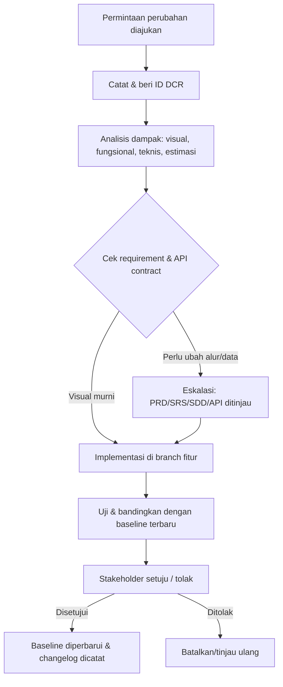
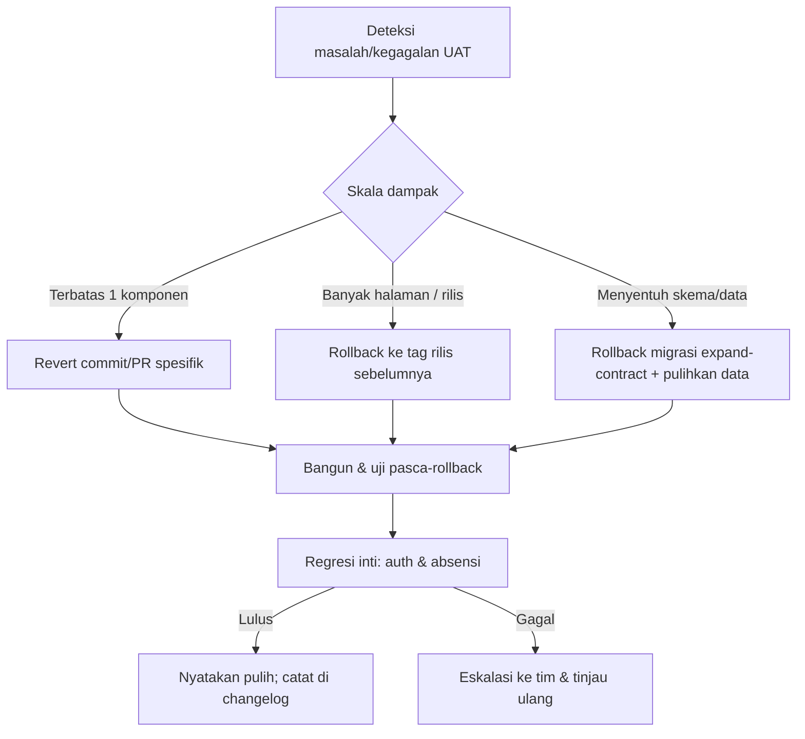

# 08 — Design Change & Backup Plan: LIMEN

- **Status dokumen:** Draft untuk ditinjau (Fase G)
- **Versi:** 0.1
- **Tanggal:** 2026-10-11
- **Dokumen terkait:** [00-project-audit.md](./00-project-audit.md) · [02-prd.md](./02-prd.md) · [03-srs.md](./03-srs.md) · [04-wbs.md](./04-wbs.md) · [05-sdd.md](./05-sdd.md) · [07-uat-checklist.md](./07-uat-checklist.md) · [09-decision-log.md](./09-decision-log.md) · [10-glossary.md](./10-glossary.md)

## 1. Tujuan

Dokumen ini mengatur cara menangani **perubahan desain** (UI/UX, visual, dan komponen) agar tidak merusak business logic, integrasi API, atau alur yang sudah diuji, serta mengatur **backup dan rollback** implementasi. Fokus pada perubahan yang diminta pengguna, stakeholder, atau tim UI/UX.

Prinsip dasar:

- Perubahan visual **murni** sedapat mungkin hanya menyentuh **design token** dan **komponen**, bukan business logic (ADR-008, [09-decision-log.md](./09-decision-log.md)).
- Perubahan yang menyentuh **alur bisnis, struktur data, atau API** diperlakukan sebagai perubahan lintas dokumen, bukan sekadar perubahan tampilan.
- **Tidak ada** perubahan desain yang langsung masuk tanpa dicatat, dianalisis, dan diuji regresi (rujuk [07-uat-checklist.md](./07-uat-checklist.md) §8.3).

## 2. Konteks Saat Ini (Fakta)

- **Belum ada aset desain resmi** dan **belum ada pemilik/penyetuju desain**; status `TBD` (DEC-14, SDD-OI-04, [02-prd.md](./02-prd.md) Q-11).
- Baseline sementara = **implementasi frontend yang ada + design token internal** (DEC-14; ADR-008 di [09-decision-log.md](./09-decision-log.md)).
- Belum ada design token terpusat; warna hex/arbitrary tersebar di 27 berkas ([00-project-audit.md](./00-project-audit.md) AUD-011).
- Belum ada beberapa bentuk reusable component lintas fitur; ada duplikasi berkas identik (AUD-008).
- Belum ada automated/visual regression test (AUD-007).

Konsekuensi: sampai baseline dan token selesai (WBS-P1-07, WBS-P2-07), perubahan visual berbiaya tinggi dan berisiko berulang (RSK-004). Dokumen ini menjadi proses mitigasinya.

## A. Baseline Design

**Tujuan:** menetapkan versi desain acuan agar "sesuai desain" dapat diuji secara objektif.

| Aspek | Ketentuan | Status |
| --- | --- | --- |
| Definisi baseline | Implementasi frontend saat ini + design token internal, sampai desain resmi tersedia | Proposed (DEC-14) |
| Pemilik/penyetuju desain | Penunjukan oleh organisasi | `TBD` (SDD-OI-04) |
| Referensi desain | Tautan/versi/tanggal disimpan di berkas desain atau catatan baseline | Belum tersedia |
| Design token | Sumber tunggal warna/tipografi/spacing/radius di `src/styles/tokens.css` | Akan dibuat (WBS-P2-07) |
| Komponen acuan | Reusable components di `src/shared/components/ui` | Akan dibuat (WBS-P2-06/07) |
| Nomor versi desain | Format `design-vX.Y` (mis. `design-v0.1` untuk baseline sementara) | `design-v0.1` (Proposed) |
| Proses persetujuan perubahan | Rujuk §B di bawah | Belum aktif |

**Aturan baseline:**

1. Satu versi desain acuan berlaku pada satu waktu; setiap perubahan yang disetujui menaikkan nomor versi.
2. Implementasi yang menyimpang dari baseline **wajib** ditandai (mis. pada PR) dan tidak dianggap "sesuai desain".
3. Saat desain resmi diterima, hanya **token** yang diharapkan berubah bila struktur komponen sudah modular; perbedaan struktur diperlakukan sebagai DCR (lihat §C).

## B. Change Request Workflow



**Langkah baku:**

1. **Ajukan** — permintaan masuk lewat kanal resmi tim (issue/tiket), deskripsi + alasan + referensi (mockup/tautan).
2. **Catat** — beri ID `DCR-<nomor>` (lihat template §G).
3. **Analisis dampak** — gunakan checklist §C; sertakan estimasi usaha sebagai asumsi eksplisit (bukan komitmen jadwal).
4. **Cek requirement & kontrak** — bila mengubah alur bisnis/data/API, validasi terhadap [03-srs.md](./03-srs.md) dan [06-api-documentation.md](./06-api-documentation.md).
5. **Persetujuan** — pemilik desain/stakeholder menyetujui atau menolak (pemilik desain saat ini `TBD`).
6. **Implementasi** — pada branch fitur terpisah (lihat §D).
7. **Uji** — jalankan regresi ([07-uat-checklist.md](./07-uat-checklist.md) §8.3) dan bandingkan dengan baseline terbaru.
8. **Catat hasil** — perbarui changelog §G dan naikkan versi baseline.

**Kriteria eskalasi** (naik ke perubahan lintas dokumen, bukan sekadar tampilan):

- Mengubah field/label yang bermakna data (mis. status absensi, enum).
- Mengubah jumlah langkah/jalur pengguna yang diuji.
- Mengubah struktur respons API atau kebutuhan data.
- Menyentuh keamanan/otorisasi tampilan per peran (BR-14).

### Contoh perubahan minor

> **DCR-001 (contoh).** Ubah warna tombol utama dari biru ke hijau. Dampak: hanya `tokens.css` (color primary). Tidak mengubah alur/API. Uji: regresi visual halaman tombol. Keputusan: disetujui → `design-v0.2`.

### Contoh perubahan major

> **DCR-002 (contoh).** Tambah kolom "Jam Pulang" pada tabel rekap absensi guru mapel. Dampak: layout tabel, komponen tabel, mungkin endpoint `GET /attendance/records` (field `checkOutAt` sudah ada, cek ketersediaan) dan test case UAT TC-ABS-10. Karena menyentuh data & pengujian, **dieskalasi** ke tinjauan SDD/API sebelum implementasi.

## C. Change Impact Analysis

Untuk setiap DCR, isi checklist dampak berikut dan tandai tingkat: `Tidak ada` / `Ringan` / `Berat`.

| Area terdampak | Pertanyaan kunci | Contoh dampak |
| --- | --- | --- |
| Page layout | Apakah struktur halaman berubah? | Grid/kolom, urutan section |
| Reusable components | Apakah komponen bersama berubah? | `Button`, `Badge`, tabel, modal |
| Design tokens | Apakah token berubah? | Warna, spacing, radius, tipografi |
| Form & validation | Apakah field/aturan validasi berubah? | Field baru, format baru |
| Routing | Apakah route/param berubah? | URL, guard, lazy chunk |
| State management | Apakah state/query berubah? | query keys, cache |
| Business logic | Apakah aturan bisnis berubah? | Status absensi, perhitungan terlambat |
| API integration | Apakah kontrak API berubah? | Endpoint/field baru |
| Accessibility | Apakah aksesibilitas terpengaruh? | Label, kontras, fokus |
| Responsive behavior | Apakah perilaku ponsel/desktop berubah? | Breakpoint, overflow |
| UAT & regression | Test case mana yang perlu dijalankan ulang? | TC-UX-*, TC-REGR-* |

**Klasifikasi perubahan:**

| Jenis | Cakupan | Proses |
| --- | --- | --- |
| **Visual murni** | Token & komponen; tanpa perubahan alur/data | DCR + regresi visual/fungsional ringan |
| **Fungsional-visual** | Mengubah interaksi/alur yang terlihat | DCR + UAT ulang test case terkait |
| **Struktural** | Mengubah data/kontrak/peran | DCR + tinjauan PRD/SRS/SDD/API + UAT penuh |

> Bila DCR termasuk **struktural**, jangan perlakukan sebagai pekerjaan FE saja; jadwalkan sebagai perubahan lintas dokumen pada [04-wbs.md](./04-wbs.md) Fase P8.

## D. Backup dan Version Control

| Aspek | Rekomendasi | Catatan |
| --- | --- | --- |
| Git & remote | Repo Git dengan remote resmi; semua pekerjaan di-commit ke repo | Mono-repo FE+BE (ADR-010) bila diterapkan |
| Branching | Branch fitur per pekerjaan/DCR (`feat/`, `fix/`, `refactor/`); `main` = stabil | Hindari commit langsung ke `main` |
| Pull request | Setiap perubahan lewat PR dengan deskripsi & ID DCR/WBS | Memudahkan review & jejak |
| Commit terfokus | Satu commit = satu perubahan logis; pesan jelas | Memudahkan `git revert` selektif |
| Tag/release | Tag `vX.Y.Z` pada tiap rilis; checkpoint sebelum change besar | Rujuk WBS-P7-04 |
| Referensi desain | Simpan versi desain yang disetujui + tautan di dokumen baseline | Jangan andalkan hanya pesan chat |
| Backup repo | Backup terjadwal (mis. mirror remote/layanan hosting) | Uji pemulihan berkala (TC-REL-05) |
| Backup aset | Aset/ikon sumber disimpan di repo, bukan hanya di berkas lokal | Menutup AUD-019 |
| Keamanan | **Jangan** simpan rahasia/token/kredensial `.env` di repo/backup | Sudah diabaikan `.gitignore` (AUD-020) |

**Strategi anti-kehilangan saat refactor:**

- Tag checkpoint **sebelum** refactor besar (WBS-P2-01/06).
- Batasi PR agar perubahan dapat direview dan dibalik.
- Simpan ringkasan perubahan pada [04-wbs.md](./04-wbs.md) dan [09-decision-log.md](./09-decision-log.md) bila menyentuh keputusan.

## E. Rollback Plan

### E.1 Kapan rollback dilakukan

1. Perubahan desain merusak layout yang sudah stabil.
2. Perubahan komponen menimbulkan regresi pada banyak halaman.
3. Implementasi desain baru belum memenuhi UAT (TC-UX-* / TC-REL-*).
4. Perubahan visual memengaruhi alur bisnis atau integrasi API.
5. Rilis baru harus dikembalikan ke versi sebelumnya.

### E.2 Prasyarat rollback

- Rilis/tag sebelumnya tersedia di Git.
- Perubahan berada pada commit/PR terpisah sehingga dapat dibalik selektif.
- Migrasi database mengikuti pola **expand-contract** (ADR-015) agar dapat dibalik tanpa kehilangan data.
- Backup data terkini tersedia sebelum rollback skema.

### E.3 Prosedur



**Langkah:**

1. Konfirmasi masalah dan tetapkan skala (komponen tunggal vs rilis).
2. Pilih jalur: `git revert` commit/PR spesifik, atau kembalikan ke tag rilis sebelumnya.
3. Untuk skema: jalankan langkah `down` **hanya** di non-produksi; di produksi gunakan langkah pemulihan expand-contract (jangan hapus kolom/tabel sebelum data aman).
4. Bangun ulang dan jalankan verifikasi pasca-rollback.
5. Jalankan regresi inti: autentikasi (TC-AUTH-*) dan absensi (TC-ABS-*) minimal.
6. Nyatakan pemulihan dan catat pada changelog §G (status rollback).

### E.4 Validasi pascarollback

- Alur absensi inti (masuk/pulang/terlambat/tanda merah) berjalan.
- Login/sesi/logout berjalan.
- Tidak ada error konsol/kegagalan build.
- Data tidak hilang/duplikat.

### E.5 Pihak yang menyetujui pemulihan

Pemilik produk/stakeholder bersama penanggung jawab teknis rilis. **Saat ini penanggung jawab belum ditunjuk** (hubungan dengan SDD-OI-04 / pemilik desain `TBD`); wajib ditetapkan sebelum rilis pertama.

## F. Prevention Strategy

| Strategi | Manfaat | Status |
| --- | --- | --- |
| Design token terpusat | Perubahan tema cukup di satu tempat | Akan dibuat (ADR-008, WBS-P2-07) |
| Komponen modular & reusable | Perubahan komponen tersebar otomatis | Akan dibuat (WBS-P2-06) |
| Pisahkan UI dari business logic | Perubahan tampilan tidak menyentuh aturan bisnis | Prinsip SDD §4 (ADR-005) |
| Tipe yang konsisten | Kesalahan bentuk data terdeteksi compile-time | TypeScript strict (audit) |
| Server-state via query library | Perubahan tampilan tidak mengubah cara data diambil | ADR-009 |
| Visual regression testing | Deteksi perubahan visual tak sengaja | Opsional, dinilai di WBS-P8-02 |
| Dokumentasi perubahan (DCR + changelog) | Jejak keputusan & alasan | Proses §B/§G |
| UAT & regression per rilis | Menahan regresi sebelum rilis | [07-uat-checklist.md](./07-uat-checklist.md) §8 |

**Batasan realistis:** sebagian perubahan desain **memang** memerlukan perubahan kode (struktur layout baru, field baru, komponen baru). Tidak semua perubahan dapat diselesaikan hanya dengan token. Dokumen ini mengurangi biaya, bukan menghilangkannya.

## G. Change Log dan Template

### G.1 Template Change Request (DCR)

```markdown
### DCR-<nomor> — <judul singkat>
- Tanggal diajukan: <YYYY-MM-DD>
- Pengaju: <nama/peran>
- Jenis: Visual murni | Fungsional-visual | Struktural
- Alasan/tujuan: <uraian>
- Referensi desain: <tautan/versi>
- Versi desain saat ini: <design-vX.Y>
- Dampak (lihat §C): layout / komponen / token / form / routing / state / bisnis / API / a11y / responsive / UAT
- Requirement terkait: <FR-*/BR-*>
- Kontrak API terdampak: <API-* atau "tidak ada">
- Estimasi usaha (asumsi, bukan komitmen): <opsional>
- Keputusan: Disetujui | Ditolak | Ditunda
- Penyetuju: <nama/peran>
- Implementasi: <branch/PR/commit>
- Hasil pengujian: <test case & status>
- Rollback dilakukan: Ya | Tidak; alasan
- Versi desain setelah perubahan: <design-vX.Y>
```

### G.2 Log Perubahan Desain

| DCR | Tanggal | Alasan | Versi desain | File/area terdampak | Keputusan | Hasil uji | Rollback | Status |
| --- | --- | --- | --- | --- | --- | --- | --- | --- |
| (contoh) DCR-001 | - | Ubah warna primary | design-v0.2 | `tokens.css` | Disetujui | TC-UX-05 | Tidak | Contoh |
| (contoh) DCR-002 | - | Tambah kolom jam pulang | design-v0.3 | tabel rekap, API | Ditinjau | TC-ABS-10 | Tidak | Contoh |

> Baris nyata ditambahkan saat DCR diajukan. Saat ini **belum ada** DCR nyata; tabel hanya berisi contoh.

## H. Keterkaitan dengan WBS dan UAT

- Proses ini dioperasionalkan pada [04-wbs.md](./04-wbs.md) **Fase P8** (WBS-P8-01/02/03).
- Regresi pasca-change desain diuji pada [07-uat-checklist.md](./07-uat-checklist.md) **TC-REGR-04**, disertai TC-UX-01..05.
- Rollback diuji pada TC-REL-03; backup pada TC-REL-05.
- Design token & komponen adalah prasyarat pencegahan (WBS-P2-06/07); baseline desain prasyaratnya adalah WBS-P1-07 (DEC-14).

## I. Catatan Konsistensi

- Istilah mengikuti [10-glossary.md](./10-glossary.md).
- Keputusan desain yang belum final tetap `Proposed`/`TBD` (DEC-14, ADR-008); dokumen ini tidak mengangkatnya menjadi final.
- Tidak ada timeline/estimasi yang dikomitmenkan; estimasi usaha (bila diperlukan) adalah asumsi eksplisit.
- Tidak ada kode aplikasi yang diubah oleh dokumen ini.