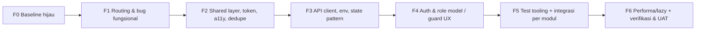
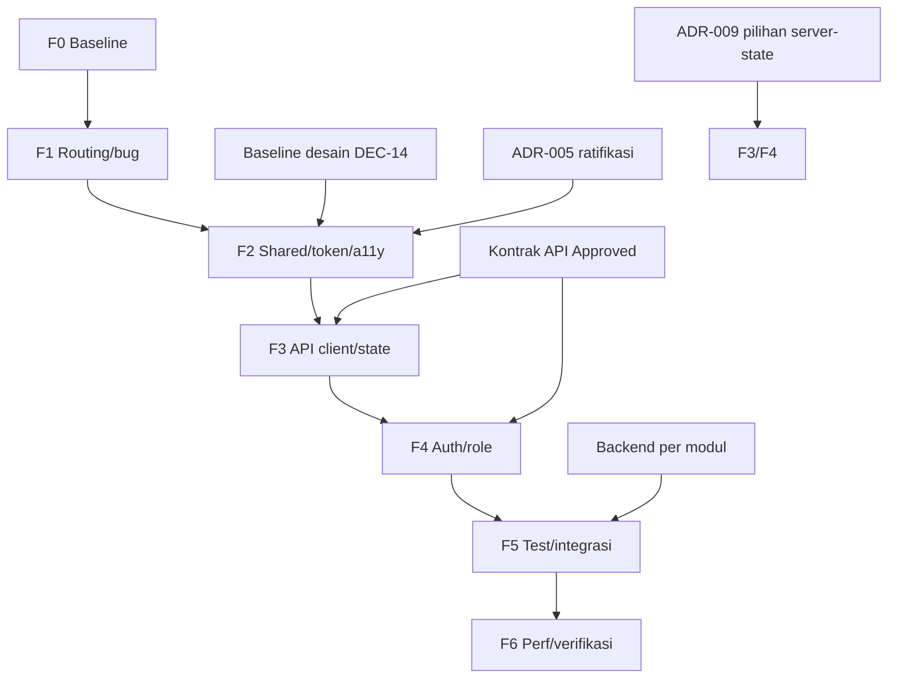

# 11 — Frontend Refactor: Migration Plan (Fase 0)

- **Status dokumen:** Draft untuk ditinjau (perencanaan; **belum ada kode yang diubah**)
- **Versi:** 0.1
- **Tanggal:** 2026-10-11
- **Branch:** `refactor`
- **Peran penulis:** Senior Frontend Architect
- **Dokumen terkait:** [00-project-audit.md](./00-project-audit.md) · [01-project-overview.md](./01-project-overview.md) · [02-prd.md](./02-prd.md) · [03-srs.md](./03-srs.md) · [04-wbs.md](./04-wbs.md) · [05-sdd.md](./05-sdd.md) · [06-api-documentation.md](./06-api-documentation.md) · [07-uat-checklist.md](./07-uat-checklist.md) · [08-design-change-backup-plan.md](./08-design-change-backup-plan.md) · [09-decision-log.md](./09-decision-log.md)

> **Batas Fase 0.** Dokumen ini adalah **rencana**. Tidak ada perubahan pada source code, dependency, `package.json`, konfigurasi, maupun dokumen spesifikasi. Semua struktur folder target bersifat **usulan** (merujuk [05-sdd.md](./05-sdd.md)), bukan keputusan final. Implementasi dimulai hanya setelah keputusan pada §11 disepakati.

## 1. Tujuan dan Ruang Lingkup

Tujuan: menyiapkan migrasi frontend yang **realistis, terukur, dan bertahap** dari kondisi aktual ke target [05-sdd.md](./05-sdd.md) tanpa merusak fitur yang masih berfungsi.

Ruang lingkup: seluruh `src/` (171 berkas), routing, komponen, tipe, mock data, styling, dan konfigurasi build. Backend **di luar** lingkup ini.

## 2. Kondisi Aktual Terverifikasi (sebelum migrasi)

Sumber: [00-project-audit.md](./00-project-audit.md) (status `Verified`) + pengukuran ulang pada Fase 0 ini.

| Aspek | Kondisi | Bukti |
| --- | --- | --- |
| Framework | React 19.2, TypeScript ~6.0 (`strict`, `noUnusedLocals`, `noUnusedParameters`) | `package.json:18`, `tsconfig.app.json:20-23` |
| Build tool | Vite 8 + `@vitejs/plugin-react` | `package.json:35`, `vite.config.ts:2,7` |
| Styling | Tailwind CSS v4; tanpa design token (`index.css:1` hanya `@import "tailwindcss"`) | `package.json:17,21`, `src/index.css:1` |
| Routing | ±62 route inline, tanpa layout/lazy/guard | `src/App.tsx:63-239` (AUD-005) |
| State | Hanya React state lokal + 1 context (quiz); tanpa state library | `src/features/quiz/QuizContext.tsx` |
| Data | Semua mock/inline; tanpa API client, tanpa `.env` | AUD-004 |
| Testing | Tanpa runner/library/test; tanpa script `test` | `package.json:6-11` (AUD-007) |
| Autentikasi | Tidak ada; login hanya `navigate("/dashboard")`; input tidak di-bind | `src/features/login/Login.tsx:11-14,24-42` (AUD-001) |

### 2.1 Baseline tooling dijalankan pada Fase 0 (bukti eksekusi)

Perintah dijalankan langsung di branch `refactor` (bukan asumsi):

| Perintah | Hasil | Keterangan |
| --- | --- | --- |
| `npm run lint` | **GAGAL** — 3 error, 0 warning | `guruBK/Rekap/shared.tsx:7` (`react-refresh/only-export-components`); `guruMapel/absensi/DaftarSiswaTab.tsx:17` (`setDaftarSiswa` unused); `hasil-minat-bakat/Dropdown.tsx:11` (`label` unused). |
| `npx tsc -b` (dipakai `npm run build`) | **GAGAL** — 13 error `TS6133` | Lihat daftar §2.2. `dist/` **tidak** dihasilkan. |
| `npx tsc --noEmit -p tsconfig.app.json` | **GAGAL** — 13 error `TS6133` | Sama dengan di atas. |

> **Temuan material (baru).** Klaim pada `plan.md` bahwa "tidak ada error compile/lint dan baseline sehat" **tidak akurat saat ini**: `npm run build` tidak dapat hijau karena langkah `tsc -b` gagal lebih dulu. Audit [00-project-audit.md](./00-project-audit.md) memang tidak menjalankan build, sehingga kesimpulan ini baru terverifikasi sekarang. **Stabilisasi baseline menjadi prasyarat mutlak fase pertama** (lihat GAP-FE-18 dan Fase F0).

### 2.2 Daftar error `tsc -b` (13)

```
bankSoalData.tsx(46,19)              'id' declared but never read
bankSoalDataUjian.tsx(46,19)         'id' declared but never read
guruMapel/absensi/DaftarSiswaTab.tsx(17,23)  'setDaftarSiswa' declared but never read
guruWali/absensi/AbsensiWaliDetailSiswa.tsx(1,1)          'React' declared but never read
guruWali/absensi/AbsensiWaliDetailSiswaDetailHari.tsx(1,1) 'React' declared but never read
guruWali/konselingWali/CatatanKonselingWali.tsx(1,8)      'React' declared but never read
guruWali/konselingWali/CatatanKonselingWaliTindakLanjut.tsx(1,8) 'React' declared but never read
guruWali/konselingWali/KonselingWali.tsx(1,8)             'React' declared but never read
guruWali/rapotSiswa/RapotAbsensi.tsx(1,1)                 'React' declared but never read
guruWali/rapotSiswa/RapotAbsensiMateri.tsx(1,1)          'React' declared but never read
guruWali/rapotSiswa/RapotSiswaWali.tsx(1,1)              'React' declared but never read
guruWali/rapotSiswa/RapotSiswaWaliDetailNilai.tsx(1,1)   'React' declared but never read
hasil-minat-bakat/Dropdown.tsx(11,3)                      'label' declared but never read
```

## 3. Skrip Validasi yang Tersedia (berdasarkan `package.json`, diverifikasi)

| Perintah | Tersedia? | Fungsi | Catatan |
| --- | --- | --- | --- |
| `npm run dev` | Ya | `vite --host` (dev server) | Verifikasi visual/manual. |
| `npm run build` | Ya | `tsc -b && vite build` | **Saat ini gagal** (tsc). Menjadi gate Fase F0. |
| `npm run lint` | Ya | `eslint .` (flat, non-type-aware) | **Saat ini gagal** (3 error). |
| `npm run preview` | Ya | `vite preview` | Untuk build hasil. |
| `npm test` | **Tidak ada** | — | Wajib ditambah untuk WBS-P2-11/NFR-MNT-002. |
| `npm run typecheck` | **Tidak ada** | — | Dapat dilakukan via `npx tsc -b` atau `npx tsc --noEmit -p tsconfig.app.json`. |
| Prettier/format | **Tidak ada** | — | Tidak ada konfigurasi format. |

> Semua fase di §8 memakai perintah yang **benar-benar ada** kecuali `npm test`, yang baru aktif setelah Fase F5 menambah tooling testing (perlu persetujuan perubahan dependency).

## 4. Matriks Gap

Kolom: **Gap ID**, **Area terdampak**, **Kondisi aktual**, **Kondisi target**, **Bukti lokasi file**, **Risiko**, **Prioritas**, **Dependensi**, **Rekomendasi**. Prioritas: Critical / High / Medium / Low.

| Gap ID | Area | Kondisi aktual | Kondisi target | Bukti | Risiko | Prioritas | Dependensi | Rekomendasi |
| --- | --- | --- | --- | --- | --- | --- | --- | --- |
| GAP-FE-01 | Autentikasi & otorisasi | Tidak ada login nyata, sesi, maupun guard; seluruh route publik | Login email+password, sesi, guard UX, dashboard per peran | `Login.tsx:11-14,24-42`; `App.tsx:63-239` (AUD-001) | Akses tanpa izin; integrasi tertunda | Critical | API-AUTH-*, ADR-003/004, DEC-05 | Bangun `shared/api/client`, SessionProvider, ProtectedRoute (UX), model role; otorisasi tetap di backend |
| GAP-FE-02 | Routing quiz | Route `:quiz_id` vs `useParams().id` → `undefined` → `/notfound` | Nama param kanonik tunggal | `App.tsx:70` vs `Quiz.tsx:66`; `Header.tsx:17` (AUD-002) | Fitur quiz tidak dapat dibuka | High | — | Tetapkan param kanonik (usulan `:quiz_id`) dan samakan komponen + `matchPath` |
| GAP-FE-03 | Bank soal Ujian | Impor ganda dari modul salah; route memuat `BankSoalGuru` (LatihanSoal); 3 komponen Ujian jadi dead code | Route Ujian memakai komponen Ujian yang benar | `App.tsx:42-44,179` (AUD-003) | Dua area navigasi rusak | High | GAP-FE-08 | Perbaiki impor/route; hapus duplikasi setelah konsolidasi |
| GAP-FE-04 | Lapisan data | Tanpa API client, env, atau service layer; `fetch`/`axios` = 0 | `shared/api/client.ts` + `config/env.ts`; komponen tidak memanggil `fetch` langsung | AUD-004 | FE tidak siap integrasi | High | GAP-FE-05, kontrak API | Buat wrapper HTTP tunggal + env `VITE_API_BASE_URL` |
| GAP-FE-05 | Struktur routing | 62 route inline tanpa layout/lazy/guard; alias ganda `/guruBK/rekap/*` & `/rekap/*`; trailing slash | Routing terpusat `app/router.tsx`, layout + guard, lazy per modul | `App.tsx:63-239,223-230` (AUD-005) | Sulit dipelihara; navigasi rusak | High | ADR-005 | Ekstrak router per domain; tetapkan kebijakan alias |
| GAP-FE-06 | State async | Tanpa pola loading/error/empty; tanpa ErrorBoundary; `try/catch` = 0 | Komponen state konsisten + ErrorBoundary global | AUD-006 | Gagal data tidak tertangani | High | GAP-FE-04 | Sediakan `Loading/Empty/Error` + ErrorBoundary saat integrasi |
| GAP-FE-07 | Testing | Tanpa runner/library/test; tanpa script `test` | Vitest + React Testing Library; `npm test` | `package.json:6-11` (AUD-007) | Regresi tidak terdeteksi | High | Perubahan dependency (persetujuan) | Tambah tooling test di Fase F5, uji modul kritis (auth, absensi) |
| GAP-FE-08 | Duplikasi | Berkas identik: `bankSoalData`≡`bankSoalDataUjian` (MD5), dua `KelasCard`, dua `RekapNilai*`; KKM=75 di 2 tempat | Modul bersama terparameterisasi; tanpa berkas identik | AUD-008 | Perbaikan ganda, divergensi | Medium | GAP-FE-05 | Konsolidasi ke modul bersama; hapus salinan |
| GAP-FE-09 | Penamaan | Typo "Penialaian" (nama file & impor); `PelajaranTab.tsx` mengekspor `JadwalTab`; campur casing | Konvensi penamaan konsisten | `GuruPenialaianKelasSiswa.tsx`; `App.tsx:52`; `PelajaranTab.tsx:8` (AUD-009) | Kebingungan impor | Medium | — | Standarkan konvensi; perbaiki typo dengan kontrol referensi |
| GAP-FE-10 | Dead code/placeholder | `QuizNotFound` tak diimpor; `BottomNav` hanya baris komentar; `Dropdown` tak dipakai; `GuruRemedial` kosong; `link:"#"`; `adminFeatures=[]` | Placeholder ditandai/rapikan; dead code dihapus setelah konfirmasi | AUD-010 | Beban pemeliharaan | Medium | GAP-FE-08 | Tandai/hapus dengan verifikasi referensi |
| GAP-FE-11 | Design token | Tanpa token; 27 berkas warna hex/arbitrary; ukuran arbitrary (`w-6!`,`h-38`) | Token terpusat `styles/tokens.css` (Tailwind v4 `@theme`) | AUD-011 | Perubahan desain mahal | Medium | ADR-008, DEC-14 | Tetapkan token warna/tipografi/spacing/radius |
| GAP-FE-12 | Aksesibilitas | `lang="en"`; tombol ikon tanpa label; modal tanpa `role="dialog"`/focus trap; `alt` minim | `lang="id"`; label; dialog semantik; WCAG 2.1 AA best-effort | `index.html:2`; `Header.tsx:38,49-81` (AUD-012) | Kepatuhan rendah | Medium | GAP-FE-11 | Perbaiki bahasa, label, semantik dialog, alt |
| GAP-FE-13 | Model role | Role hanya di mock dashboard; tanpa model/permission terpusat | Tipe + utilitas peran; menu per peran dari `/auth/me` | `dashboard/data.mock.ts:2-5` (AUD-013) | Tak ada dasar otorisasi FE | Medium | GAP-FE-01 | Definisikan model role/permission (BR-14/DEC-07) |
| GAP-FE-14 | Modul Admin | Sidebar tak tampil di mobile; pencarian tanpa state; aksi `console.log` | Fungsi nyata (bukan `console.log`) | `AdminDashboard.tsx:27`; `AkademikDanJadwal.tsx:61-65`; `ManajemenPengguna.tsx:75` (AUD-014) | Admin belum dapat diuji | Medium | GAP-FE-01/04 | Lengkapi setelah API tersedia; tandai sebagai belum lengkap |
| GAP-FE-15 | Public API modul | Hanya 1 barrel (`AdSlider`); kedalaman impor relatif tak konsisten | Aturan impor + public API per modul | `components/AdSlider/index.ts` (AUD-015) | Onboarding/refactor sulit | Low | GAP-FE-05 | Tetapkan aturan impor & barrel |
| GAP-FE-16 | Encoding | Mojibake `•`, `→` | UTF-8 benar (`•`, `→`) | `QuizResult.tsx:48`; `TambahTargetJurusanLain.tsx:109,112` (AUD-016) | Teks salah tampil | Low | — | Betulkan saat refactor |
| GAP-FE-17 | Debug | 13 berkas `console.log`; 2 `alert(` | Tanpa debug | AUD-017 | Noise/kebocoran info | Low | — | Bersihkan saat refactor |
| GAP-FE-18 | Baseline build/lint | `npm run lint` gagal (3 error); `tsc -b` gagal (13 error) → `npm run build` gagal | `lint` & `build` hijau tanpa perubahan perilaku | §2.1/§2.2 (bukti eksekusi) | Tidak ada baseline andal; regresi tak terdeteksi | Critical | — | Fase F0: perbaikan minimal (hapus unused, pisahkan ekspor non-komponen) |
| GAP-FE-19 | Dokumentasi struktur | `plan.md` basi (merujuk `src/router.tsx`, `doc/Struktur_Folder.md`, `SerchBar` yang tidak ada); klaim baseline sehat tidak akurat | Sumber kebenaran struktur menggantikan `plan.md` | `plan.md:7,39,53-62`; `docs/restructure/PROMPT_GUIDE_FOR_USER.md` (0 byte) (AUD-018) | Arahan struktur hilang/menyesatkan | Medium | — | Perlakukan `plan.md` sebagai usang; jadikan dokumen `docs/` sebagai acuan |

## 5. Inventaris Komponen: Pertahankan / Pindahkan / Perbaiki / Rancang Ulang

### 5.1 Pertahankan (sudah baik, jangan ganti tanpa alasan)

| Area | Alasan |
| --- | --- |
| Struktur `src/features/*` (15 domain) | Sudah dominan feature-first; selaras ADR-005 (SDD §3). |
| Reusable components `Button`, `XPadding`, `Header`, `KelasCard`, `NilaiBadge`, `IconNilai`, `QuizItemCard` | Sudah dipakai lintas fitur, cukup rapi. |
| Fitur quiz (context + komponen jawaban 5 tipe) | Fungsional; cukup tambah tipe/param. |
| Tailwind v4 mobile-first | Selaras NFR-USE-001 (Confirmed). |
| `types/jadwal.ts`, `data/jadwal/jadwalData.ts` | Tipe domain jadwal; hanya direlokasi. |
| `AdSlider` (barrel `index.ts`) | Satu-satunya public API yang sudah terbentuk. |

### 5.2 Pindahkan (relokasi tanpa perubahan perilaku)

| Dari | Ke (usulan, SDD §3.1) | Catatan |
| --- | --- | --- |
| `src/App.tsx` (routing inline) | `src/app/App.tsx` + `src/app/router.tsx` | Pisahkan definisi route. |
| `src/components/*` | `src/shared/components/*` | Komponen lintas fitur; hapus duplikat. |
| `src/pages/NotFound.tsx` | `src/shared/pages/NotFound.tsx` | Halaman lintas fitur. |
| `src/types/jadwal.ts` | `src/features/jadwal/model/` + `src/shared/types/` | Tipe dekat domain. |
| `src/data/jadwal/` | `src/features/jadwal/api/` (mock) | Dipensiunkan saat integrasi API. |

### 5.3 Perbaiki (bug/fondasi tanpa ganti desain)

| Item | Tindakan | Gap |
| --- | --- | --- |
| Param route quiz | Samakan nama param (usulan `:quiz_id`) | GAP-FE-02 |
| Impor/route bank soal Ujian | Gunakan komponen Ujian benar | GAP-FE-03 |
| `Header.tsx` `matchPath` | Selaraskan dengan param kanonik | GAP-FE-02 |
| Typo "Penialaian", `PelajaranTab`→`JadwalTab` | Perbaiki nama/ekspor | GAP-FE-09 |
| `index.html lang`, dialog semantics, label ikon | Perbaiki | GAP-FE-12 |
| Navigasi literal tanpa substitusi param | Perbaiki (`KonselingWali.tsx:98`, `HasilMinatBakat.tsx:169-172`) | GAP-FE-05 |
| Mojibake, `console.log`, `alert` | Bersihkan | GAP-FE-16/17 |
| lint + `tsc` errors | Perbaikan minimal | GAP-FE-18 |

### 5.4 Rancang Ulang (perubahan substantif)

| Item | Alasan | Gap |
| --- | --- | --- |
| `Login.tsx` | Tanpa state/validasi/auth → bentuk form terkontrol + service auth | GAP-FE-01 |
| `Dashboard.tsx` + `data.mock.ts` | Mock hardcoded → role dari `/auth/me` + data modul | GAP-FE-13 |
| `AdminDashboard` + `section/*` | Belum lengkap; aksi hanya `console.log` | GAP-FE-14 |
| `GuruRemedial.tsx` | Placeholder kosong (DEC-09) | GAP-FE-10 |
| `hasil-minat-bakat/Dropdown.tsx` | Tidak dipakai, prop `label` tak dirender | GAP-FE-10 |
| `BottomNav` | Hanya direferensikan baris terkomentar | GAP-FE-10 |
| Design token | Belum ada | GAP-FE-11 |

## 6. Konflik yang Harus Diselesaikan

| ID | Konflik | Bukti | Rekomendasi penyelesaian |
| --- | --- | --- | --- |
| C-01 | `plan.md` menyatakan baseline sehat & tanpa error compile/lint; kenyataannya `lint` dan `tsc -b` gagal | `plan.md:16` vs §2.1 | Tandai `plan.md` **usang**; jadikan dokumen `docs/` acuan; Fase F0 menutup selisih. |
| C-02 | `plan.md` merujuk berkas yang tidak ada (`src/router.tsx`, `doc/Struktur_Folder.md`, `SerchBar`) | `plan.md:53,57,61` | Abaikan referensi tak ada; jangan mengikuti `plan.md`. |
| C-03 | Target SDD memindahkan `App.tsx`/`components/`/`pages/` ke `app/`+`shared/`, tetapi ADR-005 masih **Proposed** | SDD §3.2; ADR-005 `Proposed` | Ratifikasi ADR-005 sebelum Fase F2; Fase F1 tidak menambah struktur final. |
| C-04 | Nama param quiz tidak konsisten (`:quiz_id` di route vs `id` di komponen vs `:id` di `Header`) | `App.tsx:70`, `Quiz.tsx:66`, `Header.tsx:17` | Putuskan satu nama kanonik (usulan `:quiz_id`) dan samakan semua. |
| C-05 | Dokumentasi menandai banyak aturan **Confirmed** (BR-06/10/11/13, DEC-01/02/15), tetapi implementasi masih mock dan tidak dapat diverifikasi | 03-srs §5; UAT §9.1 (69 `Blocked`) | Jangan klaim fitur selesai; tandai pada UAT; implementasi menunggu backend. |
| C-06 | Alias route ganda `/guruBK/rekap/*` dan `/rekap/*` menuju `Rekap` | `App.tsx:229-230` (AUD-005) | Tetapkan satu kanonik; pertahankan alias hanya bila dibutuhkan (jangan hapus route tanpa persetujuan). |
| C-07 | Kontrak API seluruh endpoint masih `Proposed`; kriteria No-Go mensyaratkan `Approved` saat integrasi | 06-api §; 07-uat §9.3(3) | Ratifikasi kontrak sebelum Fase F4/F5; FE memakai mock sampai `Approved`. |
| C-08 | WBS-P2-11 membutuhkan `npm test`, tetapi tidak ada script/dependency test | `package.json:6-11` | Ajukan penambahan Vitest+RTL (perubahan dependency) pada Fase F5. |
| C-09 | SDD ADR-009 mengusulkan server-state library (mis. TanStack Query) yang belum terpasang | `package.json` | Tetapkan pilihan di §11; jangan pasang sebelum kontrak API `Approved`. |

## 7. Urutan Fase Migrasi

Prinsip: (1) pulihkan baseline dulu → (2) perbaiki bug fungsional → (3) rapikan struktur bersama → (4) siapkan lapisan integrasi → (5) auth & role → (6) testing + integrasi per modul → (7) performa & verifikasi. Setiap fase **tidak menghapus route/fitur** dan menjaga aplikasi dapat dijalankan.



| Fase | Nama | Fokus | Risiko | Prasyarat |
| --- | --- | --- | --- | --- |
| F0 | Stabilisasi baseline | lint + typecheck hijau (perbaikan minimal) | Rendah | — |
| F1 | Routing & bug fungsional | Konsolidasi router, perbaiki AUD-002/003/005 | Sedang | F0 |
| F2 | Shared layer & desain dasar | `shared/`, token, a11y, dedupe, typo, kebersihan | Sedang–Tinggi | F1, ratifikasi ADR-005/008 |
| F3 | Lapisan integrasi FE | API client, env, state pattern, ErrorBoundary | Sedang | F2, kontrak API (mulai) |
| F4 | Auth & role | Login, sesi, guard UX, dashboard per peran | Tinggi | F3, kontrak `Approved`, backend auth |
| F5 | Testing & integrasi | Vitest+RTL, ganti mock per modul, admin lengkap | Tinggi | F4, backend per modul |
| F6 | Performa & verifikasi | Lazy loading, bundling, UAT, regresi | Sedang | F5 |

## 8. Detail Fase

Format tiap fase: **Tujuan · Area/file terdampak · Hasil yang diharapkan · Definition of Done · Risiko & mitigasi · Verifikasi · Kriteria penerimaan**.

### Fase F0 — Stabilisasi Baseline (Critical)

- **Tujuan:** membuat `npm run lint` dan `npm run build` (langkah `tsc -b`) hijau **tanpa mengubah perilaku**.
- **Area/file terdampak:** `guruBK/Rekap/shared.tsx`; `guruMapel/absensi/DaftarSiswaTab.tsx`; `hasil-minat-bakat/Dropdown.tsx`; `guru/LatihanSoal/bankSoalData.tsx`; `guru/Ujian/bankSoalDataUjian.tsx`; 8 berkas `guruWali/**` (unused `React`).
- **Hasil yang diharapkan:** baseline andal untuk mendeteksi regresi pada fase berikutnya.
- **Definition of Done:** `npm run lint` exit 0; `npx tsc -b` exit 0; tidak ada perubahan perilaku runtime; tidak ada route hilang.
- **Risiko & mitigasi:** menghapus variabel yang tampak unused namun bermakna → verifikasi referensi (grep) sebelum hapus; `shared.tsx` melanggar `react-refresh` (ekspor non-komponen) → pisahkan konstanta ke berkas non-komponen.
- **Verifikasi:** jalankan `npm run lint` dan `npx tsc -b`; `npm run dev` membuka route utama.
- **Kriteria penerimaan:** kedua perintah exit 0; tidak ada perubahan fungsional.

> Catatan: F0 adalah satu-satunya fase yang dapat dikerjakan **sekarang** karena tidak bergantung kontrak API. Namun tetap menunggu persetujuan implementasi (lihat §13).

### Fase F1 — Routing Consolidation & Bug Fungsional

- **Tujuan:** memusatkan routing dan memperbaiki bug fungsional terverifikasi.
- **Area/file terdampak:** `src/App.tsx` → `src/app/App.tsx` + `src/app/router.tsx` (usulan); `features/quiz/Quiz.tsx:66`; `components/Header.tsx:17`; `App.tsx:42-44,179`; navigasi literal (`guruWali/konselingWali/KonselingWali.tsx:98`, `hasil-minat-bakat/HasilMinatBakat.tsx:169-172`); alias `/guruBK/rekap/*` & `/rekap/*`; trailing slash `/guru/ujian/`.
- **Hasil yang diharapkan:** seluruh route tetap dapat diakses; quiz dapat dibuka; bank soal Ujian benar.
- **Definition of Done:** semua route lama tetap ada (tanpa penghapusan); param quiz kanonik; impor bank soal Ujian benar; `npm run lint` + `npx tsc -b` hijau.
- **Risiko & mitigasi:** memindahkan route dapat memutus navigasi → uji tiap area secara manual; perubahan param dapat memutus deep-link → telusuri semua `navigate`/`Link` yang menyebut quiz.
- **Verifikasi:** `npm run build`; navigasi manual login → dashboard → quiz → latihan → ujian → tugas → penilaian → koreksi → rekap → admin; **TC-REGR-01** ([07-uat-checklist.md](./07-uat-checklist.md)).
- **Kriteria penerimaan:** tidak ada route/fitur hilang; quiz & bank soal terbuka; build hijau.

### Fase F2 — Shared Layer, Design Token, A11y, Dedupe

- **Tujuan:** menerapkan struktur target (usulan SDD) tanpa mengubah perilaku bisnis.
- **Area/file terdampak:** `src/components/*`, `src/pages/NotFound.tsx`, `src/types/jadwal.ts`, `src/data/jadwal/*`, `src/styles/tokens.css` (baru), `index.html`; 27 berkas warna; duplikat `bankSoalData*`, `KelasCard`, `RekapNilai*`; `GuruPenialaianKelasSiswa.tsx`; `PelajaranTab.tsx`; mojibake; `console.log`/`alert`; dead code (AUD-008/009/010/011/012/015/016/017).
- **Hasil yang diharapkan:** komponen bersama di `shared/`, token terpusat, a11y dasar, tanpa duplikasi/typo.
- **Definition of Done:** lint+tsc hijau; tidak ada berkas MD5 identik; tidak ada hex arbitrary pada komponen yang dimigrasikan; `lang="id"`; dialog punya `role="dialog"`; barrel/public API per modul.
- **Risiko & mitigasi:** luas (rename banyak impor) → batasi per sub-langkah, andalkan `tsc` untuk mendeteksi impor putus, jalankan build tiap sub-langkah; perubahan ini **menunggu ratifikasi ADR-005/008**.
- **Verifikasi:** `npm run lint`, `npm run build`; uji visual halaman utama **TC-UX-01/02/04**, **TC-COMPAT-02**.
- **Kriteria penerimaan:** tidak ada regresi visual fungsional; struktur sesuai keputusan yang disetujui.

### Fase F3 — API Client, Env, State Pattern, ErrorBoundary

- **Tujuan:** menyediakan lapisan integrasi tunggal sebelum menghubungkan modul.
- **Area/file terdampak (baru/usulan):** `src/shared/api/client.ts`, `errors.ts`, `queryKeys.ts`; `src/config/env.ts`; `src/shared/components/state/*` (`Loading/Empty/Error`); `ErrorBoundary`; `src/app/providers/*`.
- **Hasil yang diharapkan:** komponen tidak memanggil `fetch` langsung; envelope error terpetakan; state async konsisten.
- **Definition of Done:** wrapper HTTP ada; `ErrorBoundary` aktif; mapping error sesuai §2.5 [06-api-documentation.md](./06-api-documentation.md); lint+tsc hijau; 401 → hook redirect login (kerangka).
- **Risiko & mitigasi:** pilihan server-state library belum final (C-09) → tetapkan di §11; jangan pasang dependency sebelum kontrak `Approved`.
- **Verifikasi:** build hijau; unit test minimal untuk client/error mapping (setelah F5) atau uji manual dengan mock.
- **Kriteria penerimaan:** tidak ada `fetch` langsung di komponen; state loading/error/empty tersedia.

### Fase F4 — Auth & Role Model (Guard UX)

- **Tujuan:** login nyata + sesi + guard UX + dashboard per peran.
- **Area/file terdampak:** `features/login/Login.tsx`; `features/dashboard/*` + `data.mock.ts`; `src/app/router.tsx` (ProtectedRoute); model role (`shared`/`features/auth/model`); `index.html`.
- **Hasil yang diharapkan:** seluruh route kecuali login terlindungi (UX); menu per peran; logout; penanganan 401.
- **Definition of Done:** `/auth/me` dipakai bootstrap; 401 → redirect login; menu per peran; **otorisasi otoritatif tetap di backend** (FR-AUTH-004, NFR-SEC-002; ADR-004).
- **Risiko & mitigasi:** kontrak auth berubah → kontrak-first (+ OpenAPI); jangan jadikan guard FE sebagai keamanan.
- **Verifikasi:** **TC-AUTH-01..06**, **TC-RLP-01..06**, **TC-COMPAT-04**; build hijau.
- **Kriteria penerimaan:** tidak ada halaman aplikasi dapat diakses tanpa login (AC-01); tiap peran hanya melihat menu haknya.

### Fase F5 — Test Tooling & Integrasi Per Modul

- **Tujuan:** menambah tooling test dan mengganti mock dengan API per modul (sejajar WBS-P4/P5).
- **Area/file terdampak:** `package.json` (script `test`, dependency Vitest+RTL — **butuh persetujuan**); `vite.config.ts` (konfigurasi test); test baru; `features/*/api` + hooks; modul admin (GAP-FE-14).
- **Hasil yang diharapkan:** `npm test` hijau; tiap modul memakai hook/api layer; admin berfungsi.
- **Definition of Done:** runner test terpasang; modul kritis (auth, absensi) teruji; tidak ada `fetch` langsung; admin bukan `console.log`.
- **Risiko & mitigasi:** scope luas → integrasi per modul mengikuti urutan backend (WBS-P4); mock divergen → test kontrak (WBS-P6-03).
- **Verifikasi:** `npm test`; `npm run build`; uji per modul (TC per modul).
- **Kriteria penerimaan:** modul terintegrasi sesuai kontrak `Approved`; test kritis hijau.

### Fase F6 — Performa, Lazy Loading & Verifikasi

- **Tujuan:** optimasi pemuatan dan verifikasi menyeluruh.
- **Area/file terdampak:** `src/app/router.tsx` (lazy + Suspense), pemisahan bundle, pembersihan sisa.
- **Hasil yang diharapkan:** route di-lazy per modul; bundel wajar; regresi nihil.
- **Definition of Done:** lint/build/test hijau; lazy aktif; UAT fungsional bertanda jelas (`Pass`/`Blocked`).
- **Risiko & mitigasi:** lazy memunculkan jeda/kosong → sediakan fallback Suspense.
- **Verifikasi:** `npm run build`; **TC-COMPAT-03** (NFR-PERF-001); **TC-REGR-01..04**; eksekusi [07-uat-checklist.md](./07-uat-checklist.md).
- **Kriteria penerimaan:** alur kritis berjalan; tidak ada regresi; NFR target yang sudah **Confirmed** terpenuhi.

## 9. Dependensi Antarfase



- **F0 → F1:** tanpa baseline hijau, regresi fase lain tak dapat dideteksi.
- **F1 → F2:** struktur `app/` diperlukan sebelum relokasi komponen.
- **F2 → F3:** token/struktur final sebelum lapisan integrasi.
- **F3 → F4:** API client & state pattern sebelum auth/role.
- **F4 → F5:** auth & guard sebelum integrasi modul.
- **Eksternal:** kontrak API `Approved` (07-uat §9.3 no-go) untuk F3+; backend per modul untuk F5; baseline desain (DEC-14) untuk F2.

## 10. Risiko & Strategi Mitigasi (ringkas)

| ID | Risiko | Dampak | Mitigasi |
| --- | --- | --- | --- |
| R-FE-01 | Refactor besar merusak route/fitur | Tinggi | Tahap per fase; larangan hapus route; `npm run build` tiap sub-langkah |
| R-FE-02 | Baseline merah menyamarkan regresi | Tinggi | F0 lebih dulu |
| R-FE-03 | Kontrak API masih `Proposed` | Tinggi | Contract-first; FE pakai mock sampai `Approved` |
| R-FE-04 | Rename/relokasi memutus impor | Sedang | Andalkan `tsc`; verifikasi grep referensi |
| R-FE-05 | Perubahan desain berulang | Sedang | Design token (GAP-FE-11, [08](./08-design-change-backup-plan.md)) |
| R-FE-06 | Duplikasi memicu divergensi | Sedang | Konsolidasi F2 (GAP-FE-08) |
| R-FE-07 | Penambahan dependency test/query tidak disetujui | Sedang | Ajukan di §11 sebelum F5 |

## 11. Keputusan yang Harus Disepakati Sebelum Implementasi

| ID | Keputusan | Memengaruhi | Status |
| --- | --- | --- | --- |
| KD-01 | Ratifikasi **ADR-005** (feature-first + lapisan `shared/`; pindah `components/`→`shared/`, `pages/`, `app/`) | Fase F2 | Proposed |
| KD-02 | Ratifikasi **ADR-008 / DEC-14** (design token; baseline = UI existing) | Fase F2 | Proposed |
| KD-03 | Nama param route quiz kanonik (usulan `:quiz_id`) | Fase F1 | TBD |
| KD-04 | Kebijakan alias route (`/guruBK/rekap/*` vs `/rekap/*`, trailing slash) | Fase F1 | TBD |
| KD-05 | Ratifikasi **ADR-009** (server-state library; mis. TanStack Query) | Fase F3/F4 | Proposed |
| KD-06 | Persetujuan menambah dependency testing (Vitest + RTL) & script `npm test` | Fase F5 | TBD |
| KD-07 | Ratifikasi kontrak API (seluruh endpoint `Approved`) | Fase F3–F5 | Blocked |
| KD-08 | Model role (mapping 5 peran PRD → kode) & **DEC-07** (BR-14) | Fase F4 | Proposed |
| KD-09 | Ratifikasi **ADR-003 / DEC-05** (session cookie, TTL, CSRF) untuk desain FE | Fase F4 | Proposed |
| KD-10 | Konfirmasi **DEC-01/02/03/15** (status absensi, keterlambatan, koreksi, absensi guru) untuk UI absensi | Fase F5 | Confirmed/Proposed |
| KD-11 | Perlakuan `plan.md` (usang) vs dokumen `docs/` sebagai acuan | Semua fase | TBD |
| KD-12 | Apakah `src/components/`→`src/shared/components/` dilakukan sekaligus (F2) atau bertahap | Fase F2 | TBD |

## 12. Traceability (ringkas)

| Gap | WBS terkait | Requirement terkait |
| --- | --- | --- |
| GAP-FE-01 | WBS-P2-02, WBS-P5-01 | FR-AUTH-001..006, NFR-SEC-001/002, AC-01/02 |
| GAP-FE-02/03/05 | WBS-P2-01 | AUD-002/003/005, TC-REGR-01 |
| GAP-FE-04/06 | WBS-P2-03/04 | IR-API-001..004, IR-UI-002 |
| GAP-FE-07 | WBS-P2-11 | NFR-MNT-002, AUD-007 |
| GAP-FE-08/09/10/15/16/17 | WBS-P2-06/09 | NFR-MNT-001, AUD-008/009/010/015/016/017 |
| GAP-FE-11/12 | WBS-P2-07/08 | IR-UI-001, NFR-USE-002/003, AUD-011/012 |
| GAP-FE-13 | WBS-P2-05, WBS-P5-02 | FR-DASH-001, BR-14/DEC-07, AUD-013 |
| GAP-FE-14 | WBS-P2-10, WBS-P5-11 | FR-ADMIN-001..003, AUD-014 |
| GAP-FE-18 | (prasyarat) | — (temuan Fase 0) |
| GAP-FE-19 | (dokumentasi) | AUD-018 |

## 13. Batasan dan Catatan Konsistensi

- Dokumen ini **tidak mengubah** kode, dependency, `package.json`, konfigurasi, atau dokumen spesifikasi. Tidak ada route/fitur yang dihapus.
- Struktur folder target mengikuti [05-sdd.md](./05-sdd.md) §3 dan berstatus **usulan** hingga KD-01 disetujui.
- Tidak ada kebutuhan bisnis, role, endpoint, atau skema baru yang dikarang; seluruh rujukan memakai ID yang sudah ada.
- Perintah validasi dilaporkan sesuai ketersediaan nyata (§3); hasil `lint`/`tsc` adalah **eksekusi nyata** pada Fase 0, bukan klaim.
- UAT pada [07-uat-checklist.md](./07-uat-checklist.md) berstatus `Blocked`/`Not Run`; dokumen ini tidak mengubah statusnya.
- Fase implementasi tidak dimulai pada Fase 0 ini.
